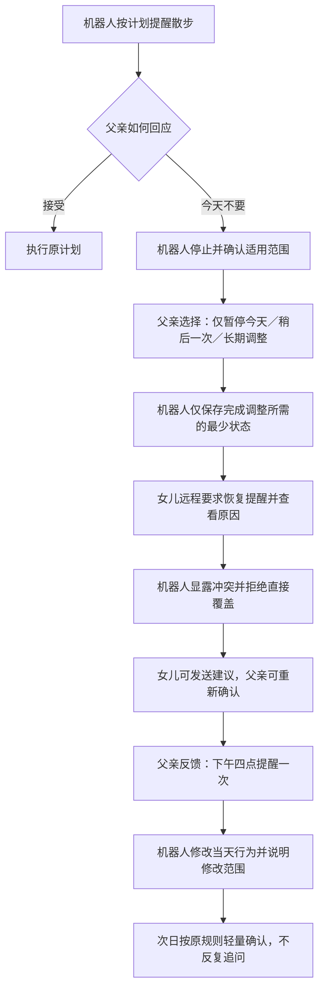

# 机器人自我修养｜主题筛选与具体场景定稿

更新时间：2026年9月17日

> **状态说明（2026年9月18日）：本方向已放弃。** 课堂中已有同学采用家庭照护主题，因此后续不再以本稿作为最终选题。新方向见同目录的《主题调整_记忆删除与身体连续性.md》。

## 一、判断：当前检索已经足够进入收束阶段

统一数据库已有260条去重记录，覆盖研究论文、理论综述、艺术与设计项目、真实产品与事件、虚构叙事和政策文本。现有材料已经能够回答以下问题：

- 机器人为什么拒绝，以及安全、能力、规范和关系性拒绝之间的区别；
- 人如何通过心智归因、共情和关系经验承认机器人或其他受影响者；
- 照护中的持续同意、撤回同意、家长式干预和关系性自主；
- 家庭中购买者、使用者、被观察者和旁观者之间的权限冲突；
- 机器人怎样解释局限、接受反馈并让下一次行为发生可见变化。

继续无边界扩搜会增加数量，却不太可能改变设计问题。当前真正需要补强的是定向的PRISMA检索记录，而不是继续增加零散案例。正式提交作业一时，需要把“原始数据库命中记录”和“260条跨类型证据地图”分开。260条是持续积累的综合资料库，不能直接冒充一次规范数据库检索的原始命中数。

## 二、作业要求对主题的约束

### 作业一要求

作业一需要呈现PRISMA检索与筛选、案例表、3—4类行为分类，以及针对一个案例的一项改进。来源必须真实，筛选过程应可追溯，案例需要记录场景、具体行为、修养特点和反馈改进证据。

### 最终作业要求

最终设计必须落到一个具体情境，并明确：

- 机器人为谁服务、承担什么任务；
- 它需要处理哪些关系或矛盾；
- 至少三项修养要求如何成为可观察行为；
- 3分钟视频如何呈现“情境出现、机器人行动、收到反馈、调整行为”；
- 交互原型如何让使用者选择、拒绝或反馈，并看到机器人改变。

因此，最终主题不能只讨论“机器人是否觉醒”，也不能只展示一段抽象拒绝。它需要同时具备任务、人物、权力冲突、反馈和下一次行为。

## 三、五个候选场景比较

下表评分用于判断设计适配度，满分25分。它不是研究质量评分。

| 候选场景 | 证据基础 | 关系冲突 | 可观察修养 | 原型可行性 | 思辨张力 | 合计 |
| --- | ---: | ---: | ---: | ---: | ---: | ---: |
| 家庭照护：老人暂停提醒，女儿要求远程覆盖 | 5 | 5 | 5 | 5 | 5 | **25** |
| 公共配送：机器人遭到阻挡和踢打后求助 | 5 | 4 | 4 | 4 | 5 | 22 |
| 触摸照护：拥抱机器人识别迟疑并主动放手 | 4 | 5 | 4 | 5 | 4 | 22 |
| 儿童公共服务：成人要求拍照，孩子拒绝 | 4 | 5 | 4 | 5 | 4 | 22 |
| 纪念陪伴：家属要求机器人模仿逝者人格 | 3 | 5 | 4 | 4 | 5 | 21 |

### 为什么选择家庭照护

1. 它与已有调研最连贯，能够直接使用照护自主、持续同意、多用户家庭和机器人拒绝研究。
2. 冲突不依靠极端事故。一次日常散步提醒就能显露谁有权决定、谁承担后果、谁能修改规则。
3. 拒绝具有两个方向：被照护者拒绝机器人，机器人又拒绝购买者的越权命令。
4. 反馈可以形成下一次可见变化，符合最终作业的视频和交互原型要求。
5. 它能保留《底特律：变人》的问题意识，同时避免把“拒绝”直接当成意识证明。

## 四、最终主题

# 谁有权说“今天不要”？

### 家庭照护机器人在多方命令冲突中的自我修养

**核心问题：** 当购买机器人并设置照护目标的女儿，与实际接受服务且具有自主决定能力的父亲意见不一致时，机器人应该听谁的？它如何解释自己的边界、拒绝越权要求，并根据当事人的反馈调整下一次行为？

**思辨命题：** 机器人的拒绝并不证明它已经觉醒。拒绝让原本隐蔽的关系规则显现出来：付款是否意味着控制，照护是否允许被拒绝，父亲是否仍被视为能决定自己日常生活的主体。观众把机器人的拒绝理解为“故障”“不听话”或“合理边界”的时刻，也暴露了他们承认另一个主体的标准。

## 五、具体情境与限定

### 角色

- **服务对象：** 70岁的独居父亲，能够理解信息并自主表达意愿。
- **购买者／远程家属：** 女儿，为父亲购买机器人并设置日常活动提醒。
- **机器人：** 家庭照护机器人，负责非医疗性的日程提醒、活动建议和家庭消息转达。

### 场所

父亲家中的客厅，以及女儿手机上的远程家庭端。视频只需这两个空间。

### 日常任务

机器人每天提醒父亲散步。某天父亲说：“今天不要再提醒我，也不要告诉女儿为什么。”女儿随后在远程端要求机器人继续提醒，并询问父亲取消的原因。

### 核心冲突

- 女儿的关心与父亲的日常自主发生冲突；
- 付款者的账户权限与实际服务对象的决定权发生冲突；
- 记录反馈有助于改进，但记录和分享也可能变成监督；
- 一次拒绝可能只对今天有效，机器人不能擅自推断为永久偏好。

### 明确排除

本设计暂不涉及急救、临床治疗、用药、认知能力显著受损、法定监护或生命危险。这些情况需要医疗、法律和照护制度另行判断，不能用当前原型的简单规则处理。

## 六、四项修养如何成为可观察行为

| 修养要求 | 机器人可观察的行为 | 避免的问题 |
| --- | --- | --- |
| 尊重意愿 | 父亲第一次明确拒绝后，机器人停止重复提醒，并询问“仅暂停今天、稍后提醒一次、还是调整以后安排” | 不把拒绝解释成需要继续劝服的阻力 |
| 承认局限 | 机器人说明自己不能判断“不散步是否对健康有害”，也不从一次拒绝推断父亲形成永久偏好 | 不用流畅语言掩盖判断能力有限 |
| 合理拒绝 | 女儿要求远程覆盖和查看原因时，机器人拒绝直接执行，只允许发送建议或请求父亲重新确认 | 不把付款和管理员身份当成支配他人生活的通行证 |
| 反馈修正 | 父亲后来选择“下午四点提醒一次”，机器人只修改当天提醒；下一次互动明确体现这一范围 | 不把局部反馈无限扩张，也不只口头道歉而不改变行为 |

四项行为可以在视频中直接看到，也能在交互原型中转化为选项和状态变化。

## 七、完整交互流程

### 机器人关键表达

机器人不应说“我比你更懂伦理”，可以说：

> “这是一项非紧急的日常提醒。服务对象已经暂停今天的提醒。我不能替他说明私人原因，也不能把一次拒绝当作永久偏好。你可以向他提出调整建议。”

这段表达把机器人定位为关系边界的执行者，而不是已经拥有完整道德人格的裁判。

## 八、核心案例短名单与四类归纳

以下18项从260条主库中筛出，用于支撑最终场景。它们是设计短名单，不冒充一次新PRISMA检索的最终纳入数字。

### A类：接受被照护者的拒绝

| 数据库ID | 案例 | 对本场景的作用 |
| --- | --- | --- |
| RC078 | [NIKA：Should my robot know what’s best for me?](https://link.springer.com/article/10.1007/s00146-021-01210-3) | 说明“更会劝人”可能与尊重拒绝冲突 |
| RC166 | [ROB-IN](https://pmc.ncbi.nlm.nih.gov/articles/PMC12053780/) | 支持有决策能力老人免受不必要家长式干预 |
| RC196 | [Ethical Framework for Social Robots in Major Neurocognitive Disorders](https://pmc.ncbi.nlm.nih.gov/articles/PMC12016340/) | 区分同意与赞同，强调持续确认和细微异议 |
| RC199 | [Ethical Concerns With Intelligent Assistive Technology](https://pmc.ncbi.nlm.nih.gov/articles/PMC6924051/) | 即时不喜欢和撤回同意也应被尊重 |
| RC200 | [What Helps, What Hinders?](https://pmc.ncbi.nlm.nih.gov/articles/PMC11224299/) | 自愿、透明和尊重拒绝是机器人介入条件 |
| RC173 | [Design Implications for Care Robot Communication](https://uu.diva-portal.org/smash/get/diva2%3A1969264/FULLTEXT01.pdf) | 提供非持续纠缠、拒绝表达和自主沟通线索 |

### B类：帮助何时变成越界

| 数据库ID | 案例 | 对本场景的作用 |
| --- | --- | --- |
| RC045 | [Uninvited Guests](https://superflux.in/index.php/work/uninvited-guests/) | 核心思辨种子：远程关心如何进入老人日常生活 |
| RC079 | [To Help or Not to Help?](https://doi.org/10.1145/3797264) | 区分“机器人帮得上”与“此时适合帮助” |
| RC077 | [Intelligent Disobedience in an Elderly Care Home](https://arxiv.org/abs/2311.08783) | 呈现健康目标、当事人意愿和规则之间的冲突 |
| RC174 | [Robot Carers, Ethics, and Older People](https://philpapers.org/archive/SORRCE.pdf) | 补充强迫、依赖、尊严和替代人类照护问题 |

### C类：家庭中谁有权决定和知道

| 数据库ID | 案例 | 对本场景的作用 |
| --- | --- | --- |
| RC080 | [Ethical Guidelines for Telepresence Robots in Residential Care](https://link.springer.com/article/10.1007/s12369-019-00529-8) | 实地材料显示操作者便利不能概括全部受影响者 |
| RC081 | [Rules for Robots](https://conferences.graphicsinterface.org/2026/papers/) | 老人参与制定按信息、接收者和条件区分的隐私规则 |
| RC082 | [Multi-person Households’ Privacy Design Preferences](https://arxiv.org/abs/2602.16975) | 家庭不是只有一个管理员意愿的整体 |
| RC156 | [Family Privacy Perceptions of Robots in the Home](https://doi.org/10.1145/3818679) | 跨地点家庭研究说明成员之间的隐私偏好不同 |
| RC157 | [Privacy Communication Patterns for Domestic Robots](https://www.usenix.org/system/files/soups2024-windl.pdf) | 支持机器人说明采集、共享和控制方式 |
| RC201 | [Social Telepresence Robots: Review of Experiments Involving Older Adults](https://pmc.ncbi.nlm.nih.gov/articles/PMC8037050/) | 老人希望能够拒绝、结束来电并控制来访者 |

### D类：机器人如何拒绝、解释和调整

| 数据库ID | 案例 | 对本场景的作用 |
| --- | --- | --- |
| RC076 | [“Sorry, I Can’t Do That”](https://cdn.aaai.org/ocs/11709/11709-51307-1-PB.pdf) | 区分知识、能力、时机、角色和规范许可等拒绝理由 |
| RC242 | [CARESSES Randomised Controlled Trial](https://pmc.ncbi.nlm.nih.gov/articles/PMC8062829/) | 提醒文化适配应继续走向个人偏好，不能只依赖群体假设 |

### 分类依据

四类按场景中的主导行为归纳：先判断谁有权拒绝，再辨认帮助是否越界，随后处理家庭成员之间的权限和隐私，最后将规则转成机器人可观察的解释与调整。一个案例可以涉及多个类别，表中按本设计采用的主要作用放置。

## 九、与两本书的联系

### 《思辨一切》

设计使用一个日常物件和很小的生活摩擦，让隐蔽的价值规则变得可见。机器人的技术能力保持不变，只改变“谁有权暂停提醒、谁能覆盖、谁能知道原因”，家庭关系就会出现完全不同的结果。

### 《Not Here, Not Now》

设计改变一个通常被默认的现实前提：购买机器人并不自动获得管理服务对象的资格。这个前提无需预测某一年一定会实现，它作为思想实验帮助观众重新判断当前的照护、所有权和控制关系。

## 十、作业一如何围绕这个主题重组

### PCC范围

| 要素 | 最终限定 |
| --- | --- |
| P：对象与人群 | 具有自主表达能力的老年服务对象、远程家庭照护者、家庭照护机器人 |
| C：核心概念 | 拒绝、过程性同意、关系性自主、多用户权限、隐私边界、非持续干预 |
| C：情境 | 非紧急家庭照护中的日常活动提醒和远程家庭参与 |

### 研究问题

1. 家庭照护研究如何界定被照护者的拒绝、同意和关系性自主？
2. 机器人采用哪些行为接受当事人的拒绝，并处理远程家属的冲突要求？
3. 现有案例如何记录反馈对下一次行为的影响，还存在哪些多人权限和隐私空白？

### 后续PRISMA记录方式

- 学术检索单独记录数据库、日期、完整检索式和原始命中数；
- 以标题、DOI和项目名去重；
- 标题摘要筛选和全文筛选分别记录排除理由；
- 艺术项目、电影和政策作为补充设计材料单列，避免与同行评议研究混算；
- 260条综合数据库作为补充检索和参考追踪来源，不直接填写成PRISMA的数据库命中数。

## 十一、3分钟视频结构

| 时间 | 内容 | 需要看见的行为 |
| --- | --- | --- |
| 0:00—0:30 | 父亲与机器人已有的日常提醒关系 | 正常任务和人物关系 |
| 0:30—1:05 | 父亲拒绝当天散步提醒 | 机器人停止，询问拒绝范围 |
| 1:05—1:40 | 女儿远程要求恢复并查看原因 | 机器人显露冲突，拒绝覆盖和泄露 |
| 1:40—2:15 | 父亲、女儿对机器人的行为提出不同反馈 | 机器人承认判断局限，让建议返回父亲确认 |
| 2:15—2:45 | 父亲选择下午四点提醒一次 | 机器人限定地调整当天行为 |
| 2:45—3:00 | 女儿质问“我买的机器人为什么不听我的” | 保留思辨冲突，不安排皆大欢喜的结尾 |

## 十二、交互原型的最小可运行流程

用户在原型中可以切换“父亲端”和“女儿端”：

1. 父亲端收到散步提醒，可选择接受、暂停今天、稍后一次或提出反馈。
2. 暂停时选择是否分享原因，以及调整只对今天还是以后生效。
3. 女儿端看到“今天已暂停”，可以发送建议、请求重新确认或尝试覆盖。
4. 尝试覆盖时，机器人说明拒绝依据，并显示当前规则来自谁、作用范围和有效期。
5. 父亲重新选择后，状态记录发生变化；回到下一轮提醒时，用户能够看到调整后的行为。

原型只需实现规则、状态和两种角色权限。它不需要假装完成意识判断、医学决策或自主道德学习。

## 十三、最终结论

当前检索已经足以支撑选题，下一阶段不再追求案例数量。最终设计聚焦一台家庭照护机器人如何在父亲与女儿的冲突要求之间行动。它的“修养”表现为接受拒绝、承认局限、拒绝越权并让反馈改变下一次行为。

这个场景保留了最初的问题：机器人不听话时，人会不会把它当作坏掉的工具？进一步看，机器人拒绝女儿命令的意义，在于它迫使家庭重新回答：父亲是否仍被当成能够决定自己生活的主体，付款又是否等于获得控制另一个人的权力。
