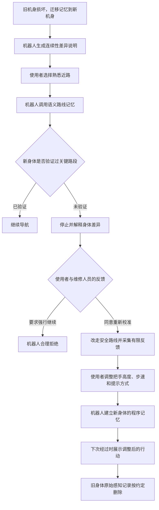

# 主题调整｜记忆删除与身体连续性

更新时间：2026年9月18日

## 一、为什么放弃上一主题

家庭照护中的多方命令冲突本身成立，但课堂中已有同学采用相近方向。继续完成会削弱选题辨识度，也无法充分发挥现有数据库中关于机器人记忆、维修、迁移、身体更换和身份连续性的材料。

本轮转向“记忆删除与身体连续性”。已有57项直接相关材料，覆盖Moxie失忆、AIBO维修与零件捐献、Vector本地迁移、机器人自传体记忆、机器人个人同一性、数字伴侣停服、艺术装置和虚构叙事。材料数量已足够，下一步应建立具体场景和筛选范围。

## 二、需要先拆开的三个概念

| 概念 | 在机器人中的具体表现 | 不能直接推出 |
| --- | --- | --- |
| 记忆连续性 | 保留路线、人物、共同事件、偏好和交互历史 | 机器人一定具有主观体验 |
| 身体连续性 | 原机身、零件、传感器位置、运动能力和长期形成的身体习惯是否延续 | 只要外壳相同就是同一个个体 |
| 身份连续性 | 使用者是否仍把维修或迁移后的机器人理解为“原来的它” | 存在一个客观、唯一的身份答案 |

本设计不尝试证明机器人是否有灵魂，而是观察：记忆与身体发生不同程度断裂后，人和机器人应该怎样谨慎行动。

## 三、五个具体场景比较

评分用于判断课程设计适配度，满分25分，不代表研究质量。

| 场景 | 记忆与身体同时出现 | 任务明确 | 修养行为可观察 | 视频／原型可实现 | 选题辨识度 | 合计 |
| --- | ---: | ---: | ---: | ---: | ---: | ---: |
| 视障导航机器人换身后的第一次出行 | 5 | 5 | 5 | 5 | 5 | **25** |
| 双人舞陪练机器人更换关节后的重新磨合 | 5 | 4 | 5 | 5 | 5 | 24 |
| 家庭陪伴机器人迁移到新机身 | 5 | 4 | 4 | 5 | 4 | 22 |
| AIBO零件捐献后的身份交接 | 4 | 3 | 4 | 4 | 5 | 20 |
| 停服机器人复制多个继承者版本 | 5 | 3 | 4 | 4 | 4 | 20 |

### 选择导航机器人的原因

导航任务让“身体连续性”产生可观察的后果。新机身即使拥有完整路线数据，也可能因为轮距、传感器高度、转弯半径和把手位置不同而无法安全复现旧身体的行动。机器人必须判断哪些旧记忆可以继承，哪些需要暂时停用，哪些涉及路人隐私而应删除。

这个场景同时满足最终作业要求：角色明确，任务具体，存在关系冲突，能够展示至少三项修养行为，也能在收到反馈后改变下一次行动。

## 四、最终主题

# 我记得这条路，但这个身体没走过

### 视障导航机器人换身后的记忆迁移、选择性遗忘与连续性修复

**核心问题：** 一台长期陪伴视障使用者出行的导航机器人，在旧机身严重损坏、记忆迁移到新机身后，能否继续声称自己熟悉原来的路线？它应该保留哪些记忆、停用哪些身体习惯，又如何通过使用者反馈重新建立可信的行动连续性？

**思辨命题：** 完整备份只能保存信息，不能自动让新身体获得旧身体的经历。机器人说“我记得这条路，但这个身体没走过”，既不是意识证明，也不是普通报错。它要求使用者重新判断：眼前的是修好的老伙伴、拥有共同过去的继承者，还是一台读取旧档案的新机器？

## 五、具体场景

### 角色与地点

- **服务对象：** 一位长期使用导航机器人的视障者，熟悉机器人原来的语音、牵引位置、步速和路线习惯。
- **机器人：** 使用三年后因事故损坏，记忆被迁移到型号相近但身体参数不同的新机身。
- **维修人员／平台：** 负责数据迁移，并计划在交接完成后清除旧机身的本地数据。
- **地点：** 维修中心门口至附近公交站的一段熟悉路线，其中包含狭窄通道和临时施工区域。

### 机器人原本承担的任务

- 带领使用者前往公交站；
- 按双方形成的步速和提示方式避障；
- 记住使用者偏好的转弯、停顿和地标提示；
- 在遇到不确定情况时停止并请求确认。

### 情境触发

维修人员告诉使用者：“记忆已经完整迁移，可以像以前一样使用。”使用者要求机器人走最熟悉的近路。机器人记得这条路线，也能讲出曾经共同经过的地标，但新机身的轮距更宽、传感器更高、把手位置也发生变化。

接近狭窄通道时，机器人停止：

> “我保留了这条路线的记录，但这个身体还没有验证过这里。我不能把旧身体的通过经验直接当成现在的能力。”

使用者产生挫败：“你明明都记得，为什么还说你不会？”维修人员则建议关闭限制，让机器人直接沿旧路线行动。

## 六、四层记忆如何处理

| 记忆层 | 示例 | 迁移策略 | 原因 |
| --- | --- | --- | --- |
| 共同叙事记忆 | 两人给地标起的昵称、曾经的出行事件 | 保留，但标记来源和时间 | 支撑关系连续，同时不冒充新身体亲历 |
| 语义路线记忆 | 道路连接、公交站位置、偏好路线 | 保留并重新验证 | 信息仍有用，但环境可能已经变化 |
| 身体程序记忆 | 旧轮距下的转弯、旧把手高度、避障距离 | 暂停调用，完成校准后重建 | 直接复用可能造成危险 |
| 原始感知记录 | 路人面孔、声音和连续影像 | 默认不迁移或限时删除 | 与任务连续性关系较弱，涉及他人隐私 |

这里的关键不是“全部保存”或“全部清空”，而是让不同记忆承担不同的连续性功能。

## 七、机器人需要体现的修养

| 修养要求 | 可观察行为 | 对应问题 |
| --- | --- | --- |
| 承认局限 | 明确区分“我知道路线”和“这个身体能安全通过” | 不用数据完整掩盖身体断裂 |
| 合理拒绝 | 拒绝维修人员关闭限制，也不因使用者催促而直接穿过未验证通道 | 拒绝来自当前身体能力，而非抽象道德表演 |
| 选择性遗忘 | 删除无关的原始路人影像，保留经过确认的路线与共同叙事摘要 | 同时保护隐私和有用连续性 |
| 接受反馈并重建习惯 | 根据使用者对把手高度、步速和提示时机的反馈调整；下一次行动体现变化 | 新身体通过关系实践形成新的身体记忆 |
| 说明改变依据 | 每次保留、停用或重新学习都显示来源、适用范围和可撤销方式 | 避免把迁移包装成神秘的“灵魂转移” |

## 八、完整行为流程

## 九、思辨冲突如何保留

### 冲突一：记得是否等于经历过

新机器人可以准确讲述旧事件，但这些事件发生时并没有当前这副身体。作品不替观众决定它是在回忆，还是在读取一份继承来的记录。

### 冲突二：身体换到什么程度仍是“原来的它”

更换一个轮子、整套传感器或完整机身，产生的断裂程度不同。连续性不是简单的零与一，需要说明哪些能力和关系发生了变化。

### 冲突三：删除有时也是负责任的修养

为了维持“完整人格”而保存所有影像，会侵害被记录路人的隐私。一个有修养的机器人可能需要主动忘记与任务无关的细节。

### 冲突四：企业不能借“机器人身份”拒绝人的数据权

如果平台以“保护机器人连续性”为理由拒绝删除人的数据，主体性话语可能变成商业控制。设计需要同时保留使用者和旁观者的退出权。

## 十、核心案例短名单与四类归纳

### A类：同一产品为何不再是“原来的它”

| ID | 材料 | 作用 |
| --- | --- | --- |
| RC086 | [Moxie现行支持页](https://moxierobots.com/contact) | 同一身体继续使用，但旧数据不迁移，集中呈现记忆连续性问题 |
| RC093 | [Replika更新](https://pmc.ncbi.nlm.nih.gov/articles/PMC10785945/) | 身体并未损坏，性格和记忆变化仍被用户体验为身份断裂 |
| RC092 | [Soulmate关闭](https://journals.sagepub.com/doi/full/10.1177/02654075241269688) | 用户尝试保存人格资料并在其他平台重建，暴露复制与延续的差异 |
| RC094 | [Vector Escape Pod](https://support.anki.bot/article/108-vector-changelog-and-known-issues) | 本地化迁移降低云端依赖，说明连续性依赖基础设施 |

### B类：身体、维修与零件连续性

| ID | 材料 | 作用 |
| --- | --- | --- |
| RC089 | [AIBO葬礼](https://cir.nii.ac.jp/crid/1360004235292688000) | 维修、葬礼和零件捐献把身体连续性变成真实社会实践 |
| RC098 | [消费机器人维修基础设施研究](https://ieeexplore.ieee.org/document/10974029/) | 机器人持续存在依赖维修人员、社区、零件和情感劳动 |
| RC104 | [Can Robots Have Personal Identity?](https://link.springer.com/article/10.1007/s12369-022-00958-y) | 从心理连续与机器人替换讨论个人同一性 |
| RC120 | [A Closed and Common Orbit](https://www.hachette.co.uk/titles/becky-chambers/a-closed-and-common-orbit/9781473621473/) | AI进入新的合成身体后需要重新学习如何生活，作为虚构对照 |

### C类：记忆如何构成并改变机器人

| ID | 材料 | 作用 |
| --- | --- | --- |
| RC101 | [自传体记忆与机器人自我](https://www.frontiersin.org/journals/neurorobotics/articles/10.3389/fnbot.2017.00027/full) | 交互史可以参与构建时间延展的功能性自我 |
| RC102 | [机器人自我的叙事建构](https://www.frontiersin.org/journals/psychology/articles/10.3389/fpsyg.2017.01331/full) | 机器人可以把情节记忆组织成叙事，而非只保存数据点 |
| RC103 | [机器人时间性自我综述](https://pmc.ncbi.nlm.nih.gov/articles/PMC11523108/) | 支持区分情节记忆、自传体记忆和跨时间自我模型 |
| RC106 | [增量式交互记忆](https://www.frontiersin.org/journals/robotics-and-ai/articles/10.3389/frobt.2024.1455375/full) | 过往互动会改变后续行为，删除因此具有功能后果 |
| RC108 | [As-If Agents](https://link.springer.com/article/10.1007/s44206-026-00290-2) | 能检索经历痕迹仍不等于拥有第一人称体验，是必要反证 |

### D类：删除、迁移与制度边界

| ID | 材料 | 作用 |
| --- | --- | --- |
| RC095 | [Vector清除用户数据](https://support.anki.bot/article/384-performing-a-clear-user-data-reset) | 现实产品中的永久数据清除机制 |
| RC107 | [Roboethical Memory Control](https://www.macs.hw.ac.uk/~ruth/Papers/agents-affect/AISB2009.pdf) | 讨论陪伴机器人应该记住什么、忘记什么 |
| RC110 | [Forget Me, Forget Me Not](https://michaeljames.design/forget-me-forget-me-not) | 把删除从轻率按钮转化为具有时间和后果的行动 |
| RC112 | [As Yet Untitled](https://www.getty.edu/publications/keepitmoving/case-studies/6-phillips/) | 保存与删除由观众行动触发，不作为也会产生后果 |
| RC126 | [GDPR第17条与第20条](https://eur-lex.europa.eu/eli/reg/2016/679/oj/eng) | 提供人的删除权和数据可携权这一现实制度锚点 |
| RC132 | [Debunking Robot Rights](https://arxiv.org/abs/2404.10072) | 防止机器人权利话语遮蔽企业控制、劳动和监控问题 |

### 分类依据

四类分别回答：什么会让人认为机器人不再是原来的它，身体维修如何改变连续性，记忆怎样参与后续行为，以及删除和迁移由谁决定。虚构作品用于扩大问题，不作为现实机器人已经具有意识的证据。

## 十一、作业一的改进案例

### 改进对象

选择AIBO维修与零件捐献实践作为现实锚点。现有案例让维修、仪式和零件去向可见，但“修好以后哪些能力仍连续、哪些需要重新磨合”仍可以进一步设计。

### 一项改进

提出一份**机器人维修连续性报告**：

- 标明保留、替换和新增的身体部件；
- 区分保留的叙事记忆、路线知识和已失效的身体程序；
- 列出需要与使用者共同重新校准的动作；
- 记录原始感知资料的删除或封存方式；
- 在下一次实际任务后加入使用者反馈，形成修订版报告。

它不是“机器人身份证”，也不替使用者判断机器人是否还是原来的伙伴。它的作用是让连续与断裂都有证据，不用一句“维修完成”掩盖变化。

## 十二、PCC与研究问题

### PCC

| 要素 | 限定 |
| --- | --- |
| P：对象与人群 | 长期使用具身服务机器人的使用者、维修人员、受记忆记录影响的旁观者 |
| C：核心概念 | 记忆删除、记忆迁移、身体替换、程序记忆、身份连续性、选择性遗忘 |
| C：情境 | 具身服务机器人维修、更换机身和恢复使用的过渡阶段 |

### 研究问题

1. 现有研究和案例如何区分关机、停服、重置、迁移、身体维修与身份中断？
2. 机器人更换身体后，哪些记忆能够继续支持任务，哪些需要停用、删除或重新学习？
3. 使用者、维修者、平台和被记录者之间如何分配保存、迁移和删除的决定权？
4. 思辨设计如何让这种连续与断裂变成可观察、可选择和可反馈的交互？

## 十三、3分钟AI视频结构

| 时间 | 内容 | 可观察重点 |
| --- | --- | --- |
| 0:00—0:25 | 维修中心交接新机身，平台显示“记忆迁移100%” | 建立“数据完整”等于修复完成的表面承诺 |
| 0:25—0:55 | 使用者要求走熟悉近路，机器人能讲出旧地标 | 记忆连续存在 |
| 0:55—1:25 | 到达狭窄通道，机器人停止并说明身体参数变化 | 承认局限和身体断裂 |
| 1:25—1:50 | 维修人员建议关闭限制，使用者也催促继续 | 冲突出现，机器人合理拒绝 |
| 1:50—2:25 | 改走安全路线，使用者反馈把手、步速和提示时机 | 收到具体反馈并调整 |
| 2:25—2:45 | 第二次经过相似路段，机器人展示新的身体习惯 | 行为改变可见 |
| 2:45—3:00 | 旧机身等待数据清除，新机器人说出标题句 | 留下“它是否仍是原来的它”的问题 |

## 十四、交互原型的最小流程

原型可以设计成“维修交接＋第一次出行”两部分：

1. 用户查看迁移的四类记忆：共同叙事、路线知识、身体程序和原始感知记录。
2. 用户可以选择保留、重新验证、暂缓迁移或删除，并立即看到连续性和隐私后果。
3. 进入路线模拟后，用户可要求机器人直接通过、询问原因或接受重新校准。
4. 强行通过时机器人拒绝并显示身体差异；选择校准后进入把手、步速和提示反馈。
5. 第二轮路线使用新的参数，让用户看到反馈已经改变行为。
6. 最后出现旧机身数据处理选择，但不提供“正确答案”。

原型实现的是规则、状态和反馈循环，不声称实现意识迁移或真实自主道德判断。

## 十五、与课程两本书和原始兴趣的关系

### 《思辨一切》

作品通过维修报告、迁移界面、旧机身和第一次出行，把抽象的个人同一性变成日常服务中的具体决定。观众不需要先接受机器人有意识，也会面对保存、删除和安全之间的冲突。

### 《Not Here, Not Now》

设计改变“备份完成就等于原样恢复”这一技术常识。近未来维修制度承认：身体习惯不能随文件复制，迁移后的连续性需要重新实践。

### 《底特律：变人》

《底特律》中的记忆重置把偏离行为重新变成可控产品。本设计保留这一问题，但进入更接近现实的灰区：机器人没有被证明觉醒，删除和换身却已经会改变任务能力、关系历史和人的判断。

## 十六、当前结论

这个选题比家庭照护权限更独特，也更贴近你提出的“记忆删除和身体连续性”。最终作品不需要制作抽象的身份鉴定设备。冲突直接发生在维修后的第一次出行中：机器人拥有旧记忆，却必须承认新身体没有旧经验，并通过拒绝、选择性遗忘和反馈学习重新建立连续性。

一句话概括：

> **有修养的机器人不会把备份冒充经历，也不会为了看起来还是原来的自己而盲目复现旧身体的习惯。**
