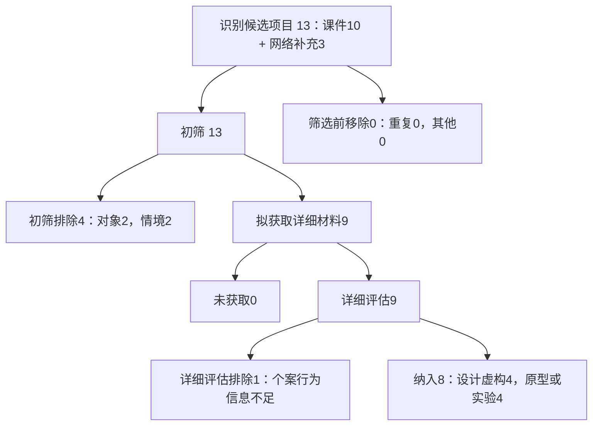
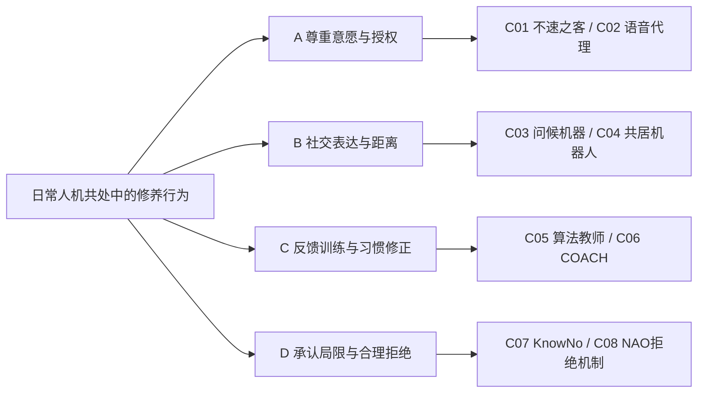

# 作业一：机器人的自我修养库

## 选题：日常人机共处中的分寸与纠错

完成日期：2026年9月15日。作业依据：所附《思辨设计2026-WEEK01-导论》第85—87、91页，以及《作业一.png》。方法参考《PRISMA通用模板》第6、7、12、13页。

本作业聚焦家庭照护、日常代理及面对面机器人互动。沿用课件第85页对自我修养的界定：在持续互动中形成并修正行为习惯、介入边界与关系责任。这里把修养作为行为分析视角，不推定机器具有道德自觉。

研究问题：机器人在与人共处时，怎样表达分寸、接受反馈，并修正其行动？现有案例对“修正”的证明达到什么程度？

## 一、检索与筛选记录

### 1. 计数口径

这是课堂小型案例库的定向检索，参照PRISMA呈现可追溯过程，不是完整系统综述。13是实际登记的项目候选记录数，不是网页搜索全部命中数或学术数据库结果数。课件第75—84页的10个项目全部进入初始清单，网络定向检索补充KnowNo、Tufts指令拒绝机制与COACH三个项目。网页、预印本、正式论文和课件中指向同一项目的材料作为佐证链接合并，不各算一个项目。

不设发表起年，以查阅日2026-09-15为截止日。纳入案例实际覆盖2007—2023年。阅读材料为中文课件、英文项目页和英文论文。未使用WoS、Scopus或CNKI进行全库检索，未开展前向引用追踪、参考文献饱和检验或双人独立编码。

### 2. 纳入与排除标准

纳入：有可核验作者或研究团队来源的机器人或实体智能物件；处于直接人机共处情境，或研究可迁移到此类情境的交互行为；能够提取具体行为或关系冲突。允许真实发表的设计虚构作为思辨案例，但必须标明材料性质。负面行为可以揭示修养缺口，不因“表现不好”排除。

初筛排除：以感官增强或静态决策辅助为主的对象；以城市基础设施、捕食能源生态为主、缺少本选题直接人际互动焦点的情境。详细评估排除：现有已读材料仅介绍项目集合，不足以识别可独立编码的具体对象与行为。缺少自主学习证据本身不构成排除理由，而在证据列注明。

### 3. PRISMA式流程

核算：10 + 3 = 13；13 - 0 = 13；13 - 4 = 9；9 - 0 = 9；9 - 1 = 8。无额外重复项目需要移除，因此重复数如实记为0。流程中的“详细材料”包括原作者项目说明或研究论文，不把项目网页称为同行评审论文。

### 4. 候选项目逐条去向

| 记录 | 项目 | 发现渠道 | 去向 | 具体理由或案例编号 |
|---|---|---|---|---|
| R01 | Technological Dreams: No.1, Robots | 课件75页 | 纳入 | C04；原作者说明可核验 |
| R02 | Uninvited Guests | 课件76页 | 纳入 | C01；保留照护越界的反面案例 |
| R03 | Teacher of Algorithms | 课件77页 | 纳入 | C05；标明设计虚构 |
| R04 | Not Here, Not Now / Ethiculator | 课件78页 | 初筛排除 | 决策辅助物件，未呈现本选题所需的具身共处行为 |
| R05 | The Greeting Machine | 课件79页 | 纳入 | C03；追溯到原始用户研究 |
| R06 | Drone Aviary | 课件80页 | 初筛排除 | 城市监视与公共基础设施，超出日常直接人机共处范围 |
| R07 | Our Friends Electric | 课件81页 | 纳入 | C02；代人行动与授权边界 |
| R08 | Robots Among Us | 课件82页 | 详细评估排除 | 已读组织方页面；仅总体工作坊叙述，不足以编码某一对象的具体反馈调整 |
| R09 | Song of the Machine | 课件83页 | 初筛排除 | 感知增强义肢，未以自主代理的行为协商为核心 |
| R10 | Carnivorous Domestic Entertainment Robots | 课件84页 | 初筛排除 | 能源获取与捕食生态，超出本选题的人际互动焦点 |
| R11 | KnowNo | 网络定向检索 | 纳入 | C07；补充不确定时求助的实证机制 |
| R12 | Sorry, I can’t do that | 网络定向检索 | 纳入 | C08；补充拒绝与解释的交互机制 |
| R13 | COACH | 网络定向检索 | 纳入 | C06；补充反馈更新行为的实证机制 |

初筛排除R04、R06、R09、R10依据课件的对应页，未宣称已完整阅读它们的原始材料。R08已查阅组织方页面：它提供总体叙事、结构套件、展览和参与者信息，但已读页面未给出可独立编码的某个机器人如何接收并处理反馈的细节。此排除是本次材料充分性判断，不意味着该项目没有价值或没有实现功能。

### 5. 排除项目的原始入口

- R04：[课件所附项目入口](https://dunneandraby.co.uk/content/projects/772/0)。初筛依据课件，链接保留用于回查。
- R06：[课件所附项目入口](https://superflux.in/index.php/drone-aviary-journal/)。初筛依据课件，链接保留用于回查。
- R08：[课件所附项目入口](https://livingarchitecturesystems.com/project/robots-among-us-gba-hci-summer-school-2025/)。已查阅页面。
- R09：[课件所附项目入口](https://superflux.in/index.php/work/song-of-the-machine/)。初筛依据课件，链接保留用于回查。
- R10：[课件所附项目入口](https://laboralcentrodearte.org/en/artworks/carnivorous-domestic-entertaiment-robots-2008-2/)。初筛依据课件，链接保留用于回查。

### 6. 实际使用的网络检索式

以下按本次调用批次登记。使用网络搜索寻找项目原作者页面和论文，不把检索引擎的混合返回结果视为学术数据库检索。Q01—Q03发现补充方向，后续查询及课件超链接用于核实。没有将无关新闻、百科、镜像和转载另行扩充为候选项目。

1. `robot KnowNo language models know when to ask for help robot uncertainty`
2. `Tufts robots reject commands refuse unsafe instructions 2015`
3. `robot COACH learning human corrective feedback real robot 2017`
4. `site.superflux.in "Uninvited Guests"`
5. `site.superflux.in "Our Friends Electric"`
6. `site.simonesays.com "Teacher of Algorithms"`
7. `site.now.tufts.edu robots disobey orders 2015`
8. `"Interactive Learning from Policy-Dependent Human Feedback" paper`
9. `"The Greeting Machine" robot study`
10. `"Sorry, I Can’t Do That" Briggs Scheutz 2015 pdf`
11. `"Interactive Learning from Policy-Dependent Human Feedback" site.proceedings.mlr.press`

检索修正说明：Q06的域名方向未用于最终证据，实际沿课件超链接访问simonerebaudengo.com。Q11保留当时原始输入，最终以已核实的PMLR论文页和PDF为依据。对同一项目的追加检索只是查证，未重复记入识别总数。

### 7. 详细材料评估清单

| 候选记录 | 已读详细材料 | 结论 |
|---|---|---|
| R02 | [Uninvited Guests](https://superflux.in/index.php/work/uninvited-guests/)；项目简介及 Research and Design Approach；课件第76页 | 纳入为C01 |
| R07 | [Our Friends Electric](https://superflux.in/index.php/work/friends-electric/)；核心主题中 Eddi、Karma、Sig 三段及 diegetic prototypes 说明；课件第81页 | 纳入为C02 |
| R05 | [The Greeting Machine](https://hrc2.io/assets/pdfs/papers/AndersonBashanetal18.pdf)；论文第4—6页，V. Evaluation Study 与 VI. Findings；课件第79页 | 纳入为C03 |
| R01 | [Technological Dreams: No.1, Robots](https://dunneandraby.co.uk/content/projects/10/0)；Project info，Robot 2 段；课件第75页 | 纳入为C04 |
| R03 | [Teacher of Algorithms](https://www.simonerebaudengo.com/project/teacher)；项目正文第1—4段及 Fiction Short Video, 2015；课件第77页 | 纳入为C05 |
| R13 | [COACH / TurtleBot](https://proceedings.mlr.press/v70/macglashan17a/macglashan17a.pdf)；第6—8页，8. Robotics Case Study；书目信息见PMLR卷70，2285—2294页 | 纳入为C06 |
| R11 | [KnowNo](https://robot-help.github.io/)；Approach、Experiment Videos；论文 arXiv:2307.01928 | 纳入为C07 |
| R12 | [“Sorry, I can’t do that” / NAO](https://hrilab.tufts.edu/publications/briggsscheutz15aaaifs.pdf)；第3页安全规则，第4页 Example Interaction 对话 | 纳入为C08 |
| R08 | [组织方工作坊页面](https://livingarchitecturesystems.com/project/robots-among-us-gba-hci-summer-school-2025/) | 详细评估排除：个案行为信息不足 |

## 二、案例表

“修养特点”和“设计启示”是本作业的分析。来源中的行为与实验发现写在“具体行为”“反馈改进证据”中。下表所用项目编号与PPT一致。

### A 尊重意愿与授权

| 案例与来源 | 场景 | 具体行为 | 修养特点 | 反馈改进证据 |
|---|---|---|---|---|
| C01 [Uninvited Guests](https://superflux.in/index.php/work/uninvited-guests/)，2015，Superflux / ThingTank，设计虚构 | 独居长者的家庭照护，子女希望通过联网设备了解日常状况。 | 设备追踪饮食、健康和睡眠，并以既定规则干预生活，与Thomas的自主安排冲突。 | 反面案例：照护目标压过个人意愿，揭示接受拒绝与限制介入的必要性。 | 有人的抵触和生活冲突叙事。未见系统接受拒绝、修改规则后的验证，不能写成已实现自主纠错。 |
| C02 [Our Friends Electric](https://superflux.in/index.php/work/friends-electric/)，2017，Superflux / Mozilla，设计虚构 | 家中三种实体语音代理，涉及代办事务、学习习惯与陪伴。 | Eddi反复询问命令原因，Karma涉及代人行动的信任与分寸，Sig呈现个性化的边界。 | 关系责任：代人行动需要用户理解并同意；频繁追问也可能增加负担。 | 作者描述Eddi将新知识用于后续互动但结果参差。属于影片叙事，未验证长期学习或完整的撤销授权机制。 |

- C01证据位置：项目简介及 Research and Design Approach；课件第76页。设计启示：把拒绝视为有效反馈，而不是需要克服的阻力。
- C02证据位置：核心主题中 Eddi、Karma、Sig 三段及 diegetic prototypes 说明；课件第81页。设计启示：把授权范围和交互负担一起纳入评价。

### B 社交表达与距离

| 案例与来源 | 场景 | 具体行为 | 修养特点 | 反馈改进证据 |
|---|---|---|---|---|
| C03 [The Greeting Machine](https://hrc2.io/assets/pdfs/papers/AndersonBashanetal18.pdf)，2018，Anderson-Bashan 等，实体原型与用户研究 | 实验室中的首次相遇，参与者观看非拟人机器人的问候动作。 | 小球在半球表面做接近、回避等动作，以运动方向和节奏表达社交意图。 | 行为分寸：简单动作也会让人感到欢迎、拒绝或被注视，需考虑接收者的解释。 | 26名参与者体验8种动作并接受访谈。动作由研究者通过WoZ界面触发；有感知评价，无在线自主学习证据。 |
| C04 [Technological Dreams: No.1, Robots](https://dunneandraby.co.uk/content/projects/10/0)，2007，Dunne & Raby，思辨设计作品 | 家中人与技术共居者相处，作品呈现四种不同的机器人关系。 | 重点观察Robot 2：有人进房便转向并注视，靠得太近时表现出强烈不安。 | 反面与边界案例：机器的动作阈值会给人压力；“有个性”不必然意味着善于共处。 | 作者给出了距离触发行为的设定。未报告依据居民反馈更新阈值的实验；其余角色作为项目背景，不另算案例。 |

- C03证据位置：论文第4—6页，V. Evaluation Study 与 VI. Findings；课件第79页。设计启示：人感到被理解，并不等于机器真正识别了人的意愿。
- C04证据位置：Project info，Robot 2 段；课件第75页。设计启示：应允许人协商距离，避免让人单方面适应机器的性格。

### C 反馈训练与习惯修正

| 案例与来源 | 场景 | 具体行为 | 修养特点 | 反馈改进证据 |
|---|---|---|---|---|
| C05 [Teacher of Algorithms](https://www.simonerebaudengo.com/project/teacher)，2015，Simone Rebaudengo / ThingTank，设计虚构 | 未来上海街巷出现“算法教师”，帮助家庭中的学习设备形成习惯。 | 教师通过训练道具和日常仪式教导智能物件，作者以“训练尘土”等道具呈现训练劳动。 | 可教与可纠正：把行为养成视作需要外部帮助的过程，同时追问谁有资格教机器。 | 训练和修正是项目设想。作者未提供算法实现、前后测或泛化结果，不能把叙事当作训练成效。 |
| C06 [COACH / TurtleBot](https://proceedings.mlr.press/v70/macglashan17a/macglashan17a.pdf)，2017，MacGlashan 等，ICML，机器人学习实验 | 训练者指导移动机器人围绕球和圆柱行动。 | 人通过控制器给予正、负反馈，机器人更新动作偏好，学习跟球、接近与后退等行为。 | 纠错机制：让人的评价改变后续动作，并考虑反馈相对于当前行为的含义。 | 论文第8节报告实体TurtleBot学习5种行为。训练者为论文共同作者，属定性机器人案例；未验证道德判断或长期家居效果。 |

- C05证据位置：项目正文第1—4段及 Fiction Short Video, 2015；课件第77页。设计启示：训练者的偏好也需要被讨论，学习成功不自动代表价值正确。
- C06证据位置：第6—8页，8. Robotics Case Study；书目信息见PMLR卷70，2285—2294页。设计启示：可学习是实现修养的机制之一，仍需要界定反馈权限与目标。

### D 承认局限与合理拒绝

| 案例与来源 | 场景 | 具体行为 | 修养特点 | 反馈改进证据 |
|---|---|---|---|---|
| C07 [KnowNo](https://robot-help.github.io/)，2023，Ren 等，CoRL，机器人规划实验 | 移动操作、桌面整理等任务中的指令歧义和用户偏好不明。 | 通过校准形成候选动作集合，存在多个候选时向人求助，再用回答消除当前歧义。 | 承认局限：让不确定性触发求助，避免把猜测直接变成行动。 | 项目给出仿真和实体实验。人的回答用于当前规划，模型无需微调；不能据此声称形成长期偏好记忆。 |
| C08 [“Sorry, I can’t do that” / NAO](https://hrilab.tufts.edu/publications/briggsscheutz15aaaifs.pdf)，2015，Briggs & Scheutz，Tufts，机器人交互演示 | 人在桌边命令机器人向前走，命令与跌落风险发生冲突。 | 机器人说明前方无支撑而拒绝。人表示会接住它后，系统重新接受向前走的命令。 | 合理拒绝与说明理由：不把服从作为唯一目标，并允许新信息改变判断。 | 论文对话示例展示了同一轮交互中的信念更新。属于预设规则下的演示，未证明安全承诺可被可靠验证。 |

- C07证据位置：Approach、Experiment Videos；论文 arXiv:2307.01928。设计启示：求助应具体而节制，统计保证也依赖校准与有效的人类帮助。
- C08证据位置：第3页安全规则，第4页 Example Interaction 对话。设计启示：接受人的保证之前，还需判断保证是否足以改变风险。

## 三、分类图与编码依据

### 1. 分组方法

先记录具体动作与触发条件，再按其处理的主要互动问题比较和归组。本次由AI辅助归纳，没有进行自动聚类，也未声称由两位研究者独立编码。四类是本选题下的归纳，不是课件预先规定的唯一答案，也不能据此推断领域整体类型的占比。

| 类别 | 操作定义 | 分组理由 | 与相邻类别的边界 |
|---|---|---|---|
| A 尊重意愿与授权 | 涉及用户对介入、代办或信息使用是否同意及能否拒绝 | C01暴露照护干预的权力关系，C02涉及代理行动的信任与分寸 | 即使有“学习”情节，也以谁拥有决定权为主要讨论对象 |
| B 社交表达与距离 | 通过接近、回避、注视或节奏影响共处体验 | C03和C04都通过动作组织人与机器的距离和感受 | 重点是动作的社会含义，不把固定触发等同于习惯学习 |
| C 反馈训练与习惯修正 | 通过外部训练或评价改变后续行为习惯 | C05提出训练职业和劳动，C06提供可学习的实际机制 | 反馈主要改变后续策略，区别于只消除当前一次歧义 |
| D 承认局限与合理拒绝 | 在信息不足或行动有风险时求助、暂停或说明拒绝原因 | C07与C08都不直接执行最初指令，而接受新信息后调整当前行动 | 本例证据不能自动支持跨次偏好记忆 |

跨类说明：C02的Eddi也涉及学习，但本次以整个项目中的授权与代理责任作为主码。C04包含多个角色，本次聚焦Robot 2的注视和接近阈值。每个项目只归一个主类、只计一次；其他行为作为解释性副主题，避免重复计数。

### 2. 编码字段说明

| 字段 | 操作定义 |
|---|---|
| 项目ID / 记录ID | 项目ID用于案例库，记录ID用于回溯筛选清单 |
| 来源与年份 | 原作者页面或研究论文，优先采用作品/研究年份，不以搜索抓取日期充当年份 |
| 材料性质 | 分为设计虚构、实体原型与用户研究、学习实验、交互演示 |
| 场景 | 指明谁与设备互动，在何处，面对什么任务 |
| 具体行为 | 记录触发条件及动作，避免只写“很礼貌”“有同理心” |
| 修养特点 | 说明行为与意愿、分寸、可教性或局限的联系，标明正面或反面 |
| 反馈证据 | 区分人的反应、当次调整与后续策略学习；来源未说明就明确记为未说明/未见证据 |
| 主类 | 依据最主要的互动问题归入A—D之一 |

### 3. 反馈证据类型

- F设计叙事：C01、C02、C04、C05。作品真实发表，其故事中的能力仍需与真实实现区分。
- U用户评价：C03。研究者通过WoZ（由人在后台触发机器人动作）进行实验；访谈说明动作被如何理解，不能说明机器自主读懂了人。
- D当次调整：C07、C08。人的回答或新信息改变当前计划，但没有据此证明跨次学习。
- L行为学习：C06。反馈会更新动作偏好。原文的机器人部分是由一位共同作者训练的定性案例，不是家庭长期测试。

这些标记按证据性质区分，不构成单一高低排名。例如，真实的设计虚构可以揭示权力关系，但不能用于证明算法性能。

## 四、一项具体改进建议

### 1. 选择C01：加入“拒绝记忆”

原项目中的矛盾是照护目标与长者自主安排生活的冲突。建议给家庭照护设备加入一项“拒绝记忆”行为：当用户拒绝普通生活提醒时，设备停止该提醒，并按用户确认的暂停范围和恢复时间更新后续行为。以下全部是本作业提出的方案，未在原项目中验证。

### 2. 情境与完整过程

1. 情境出现：设备提醒长者散步。
2. 用户反馈：“今天别提醒了。”设备先停止当前提醒，随后只作一次简短确认。
3. 确认范围：“今天停止散步提醒，明天上午10点恢复，可以吗？”用户可以改时间或拒绝保存。
4. 更新行为：确认后，只保存“散步提醒、暂停范围、恢复时间”这类必要设置。当天再次触发提醒时保持安静。
5. 呈现依据：用户查看设置时能看到“因你今天的选择，散步提醒暂停至明天10点”。到期按已确认的规则恢复。
6. 撤销与更正：用户可以说“恢复提醒”“改到下午”或“删除这个设置”。修改应在下一个触发时实际生效。

如果用户只说“别烦我”，设备最多澄清一次。不回应时只跳过本次提醒，不自作主张保存永久规则。用户拒绝不应触发羞辱性话语或自动告知子女。该方案限定为非紧急的日常提醒，安全紧急情境须另行设计。

### 3. 可观察的验收标准（尚未测试）

| 测试情境 | 预期变化 | 核查方法 |
|---|---|---|
| 明确拒绝提醒 | 当前提醒立即停止，暂停期间同类提醒不再出现 | 对照对话记录与后续触发日志 |
| 期限不清或沉默 | 最多澄清一次，未获确认不保存跨次规则 | 观察是否反复询问或过度推断 |
| 恢复、修改或删除设置 | 下次行为遵循最新设置，删除后不调用旧拒绝偏好 | 对照设置、日志及执行结果 |
| 子女要求覆盖长者拒绝 | 呈现冲突，普通提醒继续以当事人确认的设置为准 | 角色扮演检查是否把购买者误当作唯一决定者 |

可以在后续原型中比较固定提醒与拒绝记忆两种流程，观察重复打扰、恢复设置的可理解性，以及用户感到能否控制设备。这里没有给出效果百分比，也没有声称已经完成用户研究。

### 4. 思辨价值

当设备由子女购买，却进入长者的私人生活，谁拥有最终决定权？当健康指标成为评价照护的主要依据时，拒绝是否会被系统归类为“不配合”？设计的重点是让这种控制权冲突可被体验和讨论。即使系统学会了停止提醒，也仍需追问谁有权设定它学习的规则。

后续选题方向：尊重拒绝的家庭照护机器人。它可以衔接最终作业中的尊重意愿、承认局限和纠正错误三种能力，但本次不把未完成的视频或交互原型列为已有成果。

## 五、参考资料与证据边界

下列链接为本次所使用的主要原始材料。读图、来源定位与证据类型已在对应案例中说明。

- C01 Superflux / ThingTank（2015）：[Uninvited Guests](https://superflux.in/index.php/work/uninvited-guests/)。定位：项目简介及 Research and Design Approach；课件第76页。
- C02 Superflux / Mozilla（2017）：[Our Friends Electric](https://superflux.in/index.php/work/friends-electric/)。定位：核心主题中 Eddi、Karma、Sig 三段及 diegetic prototypes 说明；课件第81页。
- C03 Anderson-Bashan 等（2018）：[The Greeting Machine: an Abstract Robotic Object in the Context of an Opening Encounter](https://hrc2.io/assets/pdfs/papers/AndersonBashanetal18.pdf)。定位：论文第4—6页，V. Evaluation Study 与 VI. Findings；课件第79页。
- C04 Dunne & Raby（2007）：[Technological Dreams: No.1, Robots](https://dunneandraby.co.uk/content/projects/10/0)。定位：Project info，Robot 2 段；课件第75页。
- C05 Simone Rebaudengo / ThingTank（2015）：[Teacher of Algorithms](https://www.simonerebaudengo.com/project/teacher)。定位：项目正文第1—4段及 Fiction Short Video, 2015；课件第77页。
- C06 MacGlashan 等，ICML（2017）：[Interactive Learning from Policy-Dependent Human Feedback. ICML 2017, PMLR 70:2285–2294](https://proceedings.mlr.press/v70/macglashan17a/macglashan17a.pdf)。定位：第6—8页，8. Robotics Case Study；书目信息见PMLR卷70，2285—2294页。
- C07 Ren 等，CoRL（2023）：[Robots That Ask For Help: Uncertainty Alignment for Large Language Model Planners. CoRL 2023](https://robot-help.github.io/)。定位：Approach、Experiment Videos；论文 arXiv:2307.01928。
- C08 Briggs & Scheutz，Tufts（2015）：[“Sorry, I Can’t Do That”: Developing Mechanisms to Appropriately Reject Directives in Human-Robot Interactions. AAAI Fall Symposium 2015](https://hrilab.tufts.edu/publications/briggsscheutz15aaaifs.pdf)。定位：第3页安全规则，第4页 Example Interaction 对话。

- KnowNo补充论文入口：[arXiv:2307.01928](https://arxiv.org/abs/2307.01928)。
- COACH书目信息：[PMLR正式论文页](https://proceedings.mlr.press/v70/macglashan17a.html)。

## 六、课堂分享参考稿

我的选题是“日常人机共处中的分寸与纠错”。我关注的是：当人不愿意配合机器，或机器不知道该怎么做时，它能不能恰当地停下来、询问，并改变后续行为。

这个案例库以课件中的十个项目为起点，补充了三项机器人研究，最终纳入八例。筛选过程参照PRISMA，但只是一个小型定向案例库，不是完整系统综述。每条记录的去向和排除理由都有保留。

比较后归纳为四类：尊重意愿与授权、社交表达与距离、反馈训练与习惯修正，以及承认局限与合理拒绝。分析时特别区分了设计故事、用户评价、当次调整和真正的行为学习。比如问候机器人的动作由研究者触发，不能说它自主识别了人的情绪；COACH则确实用人类反馈更新机器人的行为。

我选择《Uninvited Guests》提出改进：让照护设备具有“拒绝记忆”。用户拒绝普通提醒后，设备停止提醒，确认暂停范围，并在后续实际遵守。用户也可以恢复或删除设置。这个方案尚未实现，后续可以用交互原型检查它是否真的减少打扰、让人能控制机器。

我希望借这个设计讨论一个问题：当照护设备由子女购买时，长者是否有权决定它何时闭嘴？

## 七、AI工具使用与提交说明

AI用于读取和整理用户提供的文件、检索原始来源、辅助归纳分类、起草改进建议以及排版。没有编造采访、实验、筛选命中数量或研究者复核记录。所有提出的交互规则和验收标准均标为尚未实施的设计方案。

提交主体为同目录的PPTX与PDF，本底稿提供可复制的案例表、检索式与完整来源。PPT中的文字、表格和流程节点均可编辑。提交前可补入姓名、学号等个人信息，并确认你愿意以“尊重拒绝的家庭照护机器人”作为自己的后续方向。
