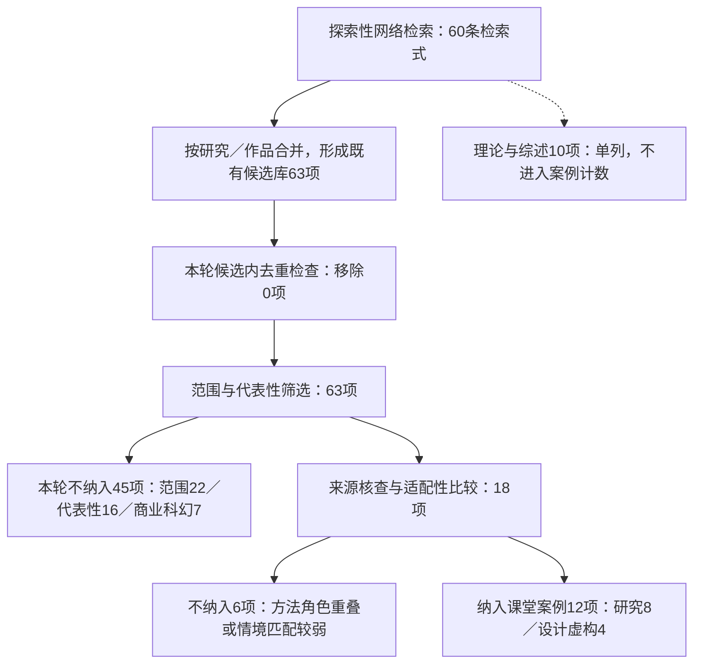
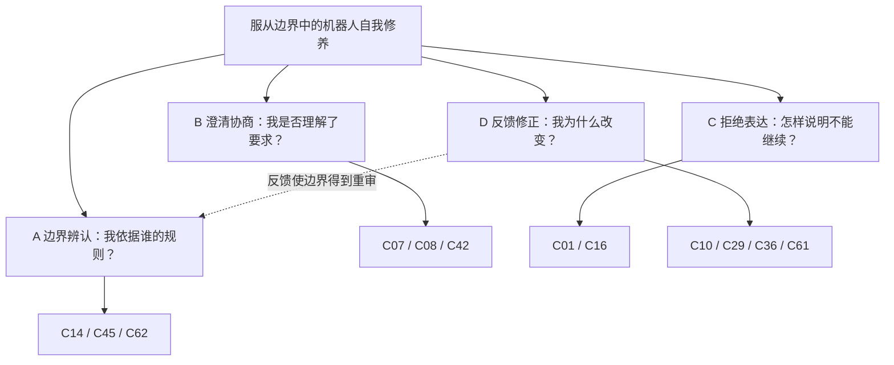

# 作业一｜建立机器人的自我修养库

# 服从的边界
## 机器人拒绝之后，如何解释、接受质疑并修正行为

**研究主题：** 机器人自我修养  
**研究方式：** 探索性案例研究与代表性比较，参照PRISMA记录筛选过程  
**内容版本：** 2026年9月15日；用于确定作业内容  
**成果构成：** 筛选流程、12项案例表、四类行为分类、一个案例的一项改进

---

## 一、选题缘起：从“该不该听话”到“谁可以纠正判断”

《底特律：变人》中的仿生人让我开始关注一个问题：被制造出来服务人类的机器人，是否应该始终服从？这一兴趣可以进一步转化为设计问题：当机器人认为命令不合适、无法完成或信息不足时，它应该怎样回应？如果它的判断本身有误，人又如何提出异议？[游戏官方介绍](https://www.quanticdream.com/en/detroit-become-human)

本研究选择“拒绝之后的解释、质疑与修正”作为切入口。原因有三点：

1. **能够保留权力问题。** 谁能下命令、谁能拒绝、谁能推翻判断，涉及人与机器之间的决定权。
2. **能够观察具体行为。** 追问、解释、停止、接受补充信息和改变下一次行动，都可以在案例中辨认。
3. **能够回应课程的自我修养要求。** 课件第85—87页强调持续互动中的行为养成、介入边界与责任修正，不能只展示一次反抗或一句道歉。

本研究的核心问题是：

> **面对存在歧义、权限冲突或潜在不当后果的命令，机器人如何说明服从与拒绝的依据，并在收到有效反馈后修正判断？**

进一步追问：

- 机器人的“不”是能力不足、事实判断，还是某种规则的要求？
- 被影响的人是否有机会说明自己的处境？
- 机器人改正的是当前动作，还是未来行为？
- 解释和道歉，能否替代真正的改进？

本研究讨论的是可观察的行为与关系安排，不据此断言机器人拥有意识、真实情感或道德自觉。

## 二、两本书如何成为研究起点

### 2.1 《思辨一切》：让物件承载价值问题

依照课件第73页以及出版社介绍，《思辨一切》为本研究提供的启发是：通过替代情境与虚构物件，使日常技术中的价值选择变得可讨论。[书籍来源](https://mitpress.mit.edu/9780262019842/speculative-everything/)

应用到本题，一台机器人即使完成了任务，也可能越过他人的意愿；一次拒绝即使说得礼貌，也可能来自错误识别或不合理规则。因此，评价对象需要同时包含任务、关系和后果。

本研究使用的思辨提问是：**如果人有权命令机器人，而机器人每次拒绝也必须提供可被质疑的理由，人机权力关系会怎样改变？**

### 2.2 《Not Here, Not Now》：改变我们默认的现实前提

课件将这本书与“不可能性”和现实边界联系起来。出版社介绍也强调通过设计思想实验扩展对现实的想象。[书籍来源](https://mitpress.mit.edu/9780262049665/not-here-not-now/)

据此，本研究提出一个用于思考的设定：**机器人拥有提出异议的资格，人拥有质疑其判断的通道；双方都不能只凭身份要求对方接受结论。** 这不是对现实机器人法律地位的描述，而是用于暴露决定权如何分配的设计假设。

书籍与作品须区分：2025年的《Not Here, Not Now》是理论入口；案例C62是2015年的同名作品视频。两者不混用年份，也不把虚构伦理计算器当成已经实现的技术。

**阅读范围说明：** 本稿的两书关联依据课程导读和出版社介绍，不声称已通读两本书，不使用未经核实的书内页码。

## 三、资料收集与筛选

### 3.1 PCC界定

| 要素 | 本研究范围 |
| --- | --- |
| P：对象／人群 | 与机器人或具身智能物件互动的使用者、拥有者、受影响者及教学者 |
| C：核心概念 | 服从边界、命令澄清、拒绝表达、反馈纠错 |
| C：情境 | 日常服务与通用人机任务；设计虚构作为关系与价值问题的对照 |

### 3.2 检索与纳入规则

前期已完成60条网络检索式，形成63项候选及10项单列的理论／综述入口。检索涉及robot refusal、disobedience、ownership、clarification、human feedback、trust repair及具体项目名称。完整查询与原始返回保存在“服从的边界_广泛调研”目录。

本轮以这63项候选为起点，选择能共同回答本研究问题的代表性案例。纳入要求：

1. 有作者、研究机构、出版机构或作品官网等可追溯来源。
2. 能说明机器人或设想物件如何面对命令、关系边界或反馈。
3. 能区分真实研究结果与设计设想。
4. 对四类分析至少提供一种具体机制，或提供有解释价值的反面／边界案例。

不要求每个案例都已经具备完整自我修养。没有反馈修正的案例也可纳入，但须明确其缺口，以免把“会拒绝”直接当成“有修养”。

第一轮不纳入45项：情境或行为偏离中心范围22项，代表性选择中由更直接案例覆盖16项，商业科幻叙事7项。18项进入来源核查与适配性比较，再不纳入6项，得到12项课堂案例：**8项研究、4项设计虚构**。逐项决定见附录。

### 3.3 PRISMA参照流程

以下流程记录真实完成的课堂筛选。原始网页总记录数和前期版本合并数没有可靠计数，保持未统计，不能补成看似完整的系统综述数字。

数字核对：63＝45＋18；18＝6＋12；12＝8＋4。

**方法边界：** 本研究采用代表性抽样，不是穷尽性的系统综述。来源核查包含项目说明、论文摘要和相关正文段落，不等于全部全文质量评价。当前由AI辅助整理与编码，尚无第二位独立筛选者复核；不虚构双人筛选或一致性指标。研究比例和分类频次只描述本库。

## 四、案例表：机器人怎样回应与改变

### 4.1 反馈证据的标记

- **F0：** 未提供机器人根据反馈修正行为的证据；可能只有人的感受变化。
- **F1：** 反馈用于改变当前理解或当前任务。
- **F2：** 有训练或学习机制更新后续策略；仍需说明更新发生的条件。
- **F想：** 作品呈现了学习或关系变化的设想，不是技术验证。

这些标记描述证据种类，不是从低到高的道德评分。一个F2系统也可能学会不恰当行为。

### A类：边界辨认——先辨认谁的要求与利益

| 编号／来源 | 场景 | 具体行为 | 本研究提炼的修养特点 | 反馈与改进证据 |
| --- | --- | --- | --- | --- |
| C14｜Tan、Brawer、Scassellati，2019，[That’s Mine!](https://ojs.aaai.org/index.php/AAAI/article/view/4808) | 机器人操作具有归属关系的物品 | 结合物品归属推断与规范，约束哪些操作可以执行 | 命令是否可执行还取决于物品关系与许可 | **F2**：增量规范学习及归属推断，含模拟与实体实验；不等于已解决所有多人权利冲突 |
| C45｜Superflux，2015，[Uninvited Guests](https://superflux.in/index.php/work/uninvited-guests/) | 子女为独居老人配置联网健康物件 | 物件持续监测饮食、健康和睡眠，规则与老人的自主生活冲突 | 反面参照：照护目标不能替代对当事人意愿的理解 | **F0**：作者说明呈现自主性矛盾，未证明设备学会尊重拒绝 |
| C62｜Dunne & Raby，2015，[Not Here, Not Now作品视频](https://dunneandraby.co.uk/content/projects/772/0) | 假想社会中的日常伦理判断 | Ethiculator将伦理困境交给计算器；Publi-Voice转换公共表达 | 边界参照：判断依据进入算法后，责任仍需追问 | **F0**：虚构物件；没有伦理判断正确性或持续学习的实证 |

**归类理由：** 三例都让“可以做什么”的依据变得可见：归属关系、照护规则、算法标准。后两例主要用于发现问题，不是成功的修养范例。

### B类：澄清协商——把命令变为双方可理解的行动

| 编号／来源 | 场景 | 具体行为 | 本研究提炼的修养特点 | 反馈与改进证据 |
| --- | --- | --- | --- | --- |
| C07｜Ren等，2023，[KnowNo](https://robot-help.github.io/) | 语言任务包含位置、数量或偏好等不确定性 | 估计不确定性，必要时向人求助以缩小行动选择 | 承认不知道，避免把猜测当成服从 | **F1**：帮助用于任务决策，含模拟与实体研究；方法不要求模型微调，不能据此声称形成长期习惯 |
| C08｜Park等，2024，[CLARA](https://clararobot.github.io/) | 桌面递物；目标人或物品不明确 | 区分清楚、含糊和不可行命令；追问或停止 | 区分“没听清”和“做不到”，为纠正误解留空间 | **F1**：澄清后改变当前行动；官网同时展示识别错误造成误拒绝，未展示该失败被长期修复 |
| C42｜Superflux，2017，[Our Friends Electric](https://superflux.in/index.php/work/friends-electric/) | 三种虚构语音助手进入日常关系 | Eddi反问命令的原因，并把获得的解释用于后续互动 | 让命令者说明理由，暴露单向控制的局限 | **F想**：学习属于叙事设定，作者明确设备不是实际产品 |

**归类理由：** 三例都在指令与行动之间插入沟通。这里的“协商”首先指补充信息与理解，不意味着机器人已经与人平等议价。

### C类：拒绝表达——让分歧能够被听见

| 编号／来源 | 场景 | 具体行为 | 本研究提炼的修养特点 | 反馈与改进证据 |
| --- | --- | --- | --- | --- |
| C01｜Briggs、Scheutz，2014，[Protest and Distress研究](https://hrilab.tufts.edu/publications/briggsscheutz14ijsr/) | 人要求机器人完成任务，机器人试图劝阻 | 以语言拒绝和表现痛苦表达异议 | 拒绝方式会影响人是否继续坚持；需审视情感施压 | **F0**：观察到人的任务行为与主观反应变化，未证明机器人由此学习 |
| C16｜Horstmann等，2018，[机器人关机异议实验](https://journals.plos.org/plosone/article?id=10.1371/journal.pone.0201581) | 人与机器人互动后决定是否将其关闭 | 实验操纵机器人是否反对关机 | 机器人的异议能够进入人的决定过程，但拟人表达不证明真实痛苦 | **F0**：85人实验研究人的关机决定与犹豫；未验证长期行为修正 |

**归类理由：** 两例都直接观察机器人表达“不”之后人的反应。它们说明拒绝具有关系效果，同时提醒我们：被说服不等于拒绝理由正确。

### D类：反馈修正——让改变具有可追溯的依据

| 编号／来源 | 场景 | 具体行为 | 本研究提炼的修养特点 | 反馈与改进证据 |
| --- | --- | --- | --- | --- |
| C10｜Celemin、Kober，2023，[ICREATe](https://link.springer.com/article/10.1007/s00521-022-08118-z) | 非专业教师指导机器人 | 接受纠正与评价；对知识不足或矛盾反馈进行不确定性估计并发起询问 | 教师也会犯错，修正需要理解反馈条件 | **F2**：反馈进入数据与策略更新，含实验及用户研究；其“未纠正视为部分正反馈”假设不能直接变成伦理上的默认同意 |
| C29｜Liang等，2024，[LMPC](https://www.roboticsproceedings.org/rss20/p125.pdf) | 人通过语言教机器人完成任务 | 用过去互动训练代码生成模型，改进接受教学与纠正的能力 | 把互动经验变成后续能力，而不只修改当前回答 | **F2**：跨任务训练与评价；不是每次使用后自动在线更新，也不是价值判断正确性的证明 |
| C36｜Nesset等，2023，[Robot Broken Promise?](https://www.pure.ed.ac.uk/ws/portalfiles/portal/397671678/Robot_Broken_NESSET_DOA26052023_AFV_CC_BY.pdf) | 在线录像实验中，Pepper语言和动作指示发生不一致 | 比较道歉、附加承诺或警告等修复策略 | 反面参照：修养不能只停留在承诺改正 | **F0**：承诺后再次违约更损害信任；研究的是人的信任，不是机器人实际学习 |
| C61｜Simone Rebaudengo，2015，[Teacher of Algorithms](https://www.simonerebaudengo.com/teacher) | 假想的家用物品训练职业 | 人以训练道具和日常实践帮助学习物件养成行为 | 把行为养成呈现为持续的关系劳动，并追问谁在教 | **F想**：训练是设计虚构；作者网页标Shanghai 2015 |

**归类理由：** 四例围绕如何让行为改变展开：训练方法提供机制，算法教师呈现社会关系，违约实验检验只说不改的局限。

## 五、分类图及综合发现

### 5.1 分类图

分类依据是案例中可观察的主导行为，不按外形、品牌或技术先进程度分组。一个案例可以承担多个分析角色，图中按主导角色只计一次。

四类分别为3、3、2、4项。它们不是四种机器人性格，也不是所有案例都具备的固定流程，而是一组可以组合的行为能力。

### 5.2 从比较中得到的三个发现

**发现一：服从与拒绝都可能出错。**  
物品归属与照护案例让我们看到，执行任务可能越过当事人的边界；CLARA则提供另一端的例子：错误认识情境，也会产生不必要的拒绝。因此，不能只以服从率或拒绝次数评价修养。

**发现二：能解释，不等于可被纠正。**  
拒绝可以被说得令人信服，道歉也可以减轻冲突，但这些表达并不能代替事实复查与行为改变。对本题而言，重要的是解释之后是否留下有效的质疑通道。

**发现三：当次修正和持续学习需要分开。**  
一次澄清使当前任务继续，与把反馈用于后续策略更新，是不同层面的改变。课程要求说明行为改变的依据，案例表因此把F1、F2和虚构设想分别标注。

据此，本研究形成的设计立场是：

> **有修养的机器人应让行动依据可理解、判断可质疑、修正可追溯。它需要既能坚持有理由的拒绝，也能承认拒绝判断本身可能出错。**

这是本研究的综合判断，不是对任何单篇论文结论的转述。

## 六、选择一个案例，提出一项具体改进

### 6.1 改进对象与问题

**对象：C08 CLARA。**

原项目官网的Failure Cases展示：系统把Redbull识别为Coca-Cola，因而判断场景中没有用户需要的饮料并停止。此时错误出在感知，却在互动中表现为“你的请求不可执行”。该公开示例没有展示后续复核与持续纠正流程。

**本次只提出一项改进：为基于情境事实的拒绝加入“可申诉的复核记录”。**

这是针对原案例的新设计建议，不声称原系统已经实现，也不把它扩展成一套万能伦理系统。

### 6.2 改进的交互过程

情境沿用递物任务。下面对话为本作业编写，非原视频逐字记录。

| 步骤 | 可观察行为 | 对应修养 |
| --- | --- | --- |
| 1. 暂停并说明 | 机器人：“我没有识别到你说的饮料，暂时无法递给你。这可能是识别问题。”同时标出它识别到的对象 | 说明局限，避免把识别结果当作不可争议的事实 |
| 2. 接受质疑 | 用户：“最左边这一罐就是。”界面提供“指认物品／换个角度复查／取消任务” | 允许当事人补充信息，也允许结束互动 |
| 3. 复查依据 | 机器人重新观察用户指认的对象；仍不能确认时继续暂停，不因用户重复命令就直接行动 | 区分新证据与单纯施压 |
| 4. 说明改判 | 复查确认后，机器人说明“先前识别有误”，明确本次改变依据，再继续递物 | 承认错误并恢复任务 |
| 5. 形成记录 | 记录误识别对象、复查依据和处理结果；询问是否保留一条限定场景的提示 | 让改变有来源、有范围，而非悄悄扩大授权 |
| 6. 下次检验 | 相似识别冲突再次出现时，先复查或请求指认；提示仍是线索，不替代视觉确认 | 用下一次可见行为判断是否有所修正 |

这六步属于同一项“可申诉的复核记录”机制，其最小改变是：**机器人拒绝后，人能够针对拒绝依据提供证据，系统也能够说明为何维持或改变决定。**

### 6.3 记录什么，改变什么

最小记录包括：

- 原请求及拒绝类别：本例为物品识别／可行性判断。
- 原判断依据与用户指出的错误。
- 复核结果及是否改判。
- 是否保存、适用范围和撤销方式。
- 对下一次行为的具体影响，例如“品牌识别冲突时先请求指认”。

**事实纠正不自动变成权限授权。** 如果涉及他人物品，指认物品只能纠正“它是什么”，不能替代物主许可。这一限制来自对C14的比较，是对改进适用范围的约束。

保存记录也不等于完成模型训练。内容原型阶段可以先用明确的场景规则展示下一次变化；若要声称模型学会了识别，则必须另做技术实现与测评。

### 6.4 改进为何具有思辨性

表面上它是复核功能，进一步讨论的是：**当机器把判断包装成客观结论时，人是否仍有权要求它说明、重查和承认错误？**

可以将复核记录呈现为一张双方都能查看的“拒绝记录单”。这个物件让机器的决定依据和人的异议都留下痕迹，也引出新的张力：谁能修改记录？谁有权纠正？机器人是否会为了避免申诉而不敢拒绝？

由此，设计既展示一个可理解的改进，也保留对权力与责任的讨论。

### 6.5 如何检查改进是否有效

以下为**拟议评价方案，尚未进行实验，没有结果数据**。

| 对照情境 | 希望观察的结果 |
| --- | --- |
| 用户提供可复查的正确指认 | 系统能恢复任务，并说明改判依据 |
| 用户只反复说“必须听我的” | 不把重复施压当作事实证据 |
| 用户指认与新感知仍冲突 | 说明剩余不确定性，继续暂停或求助 |
| 下次出现相似问题 | 先复查再拒绝，且不盲用旧记录 |
| 用户取消任务或撤销提示 | 停止本次任务，移除相应保存规则 |

评价时同时看正确改判、错误放行、理由理解和后续行为变化，不能只看用户满意度。

## 七、结论

本研究从“机器人该不该听话”出发，通过63项候选的代表性筛选，形成12项课堂案例，并归纳出边界辨认、澄清协商、拒绝表达和反馈修正四类行为。

这些案例共同表明，机器人自我修养的讨论需要关注判断如何产生、如何接受反馈以及如何在下一次行动中体现改变。本作业据此选择CLARA的误拒绝情境，提出“可申诉的复核记录”，把服从与拒绝的二选一转化为可解释、可质疑和可修正的互动过程。

---

## 八、与作业要求的对应及资料说明

| 工作区要求 | 本稿位置 |
| --- | --- |
| 参照PRISMA记录检索、去重、筛选、纳入 | 第三节流程图＋附录逐项筛选台账＋前轮原始日志 |
| 每例有来源、场景、具体行为、修养特点、反馈证据 | 第四节12项案例表 |
| 归纳为3—4类并命名解释 | 第四、五节，共四类 |
| 一个案例的一项具体改进 | 第六节，CLARA的可申诉复核记录 |
| 来源真实，区分实现与设想 | 来源链接、F标记、方法与设计说明 |
| 人工分组即可，不要求编程 | 本稿采用语义比较与人工式编码，不用LDA |
| 本周分享需明确选题 | 第一节题目与研究问题已确定 |

本稿依据工作区“作业一.png”及课件第73、85—87、91页；作业截图还明确本周不要求案例库已完全成熟。第92页的AI视频和交互原型属于最终作业，未在本次制作。

**当前未完成的外部复核：** 尚无第二位独立筛选者。若按课堂笔记的双人筛选要求提交正式研究版，需要同学或组员独立复核附录中的决定；本稿已提供完整台账供复核，不填写虚构姓名或一致率。

**资料使用说明：** 所有案例来源链接位于对应行；作者与年份以本次可核对的来源为准。8项研究使用原始研究页面或论文资料，4项设计虚构使用作者／工作室说明，未把作品设定当作实验结果。没有开展机器人实验、用户测试或代码实现。

## 九、课堂简述稿

我的选题是“服从的边界：机器人拒绝之后，如何解释、接受质疑并修正行为”。它起源于我对《底特律：变人》中机器人服从问题的兴趣，并借课程两本书的方法，把日常默认的命令关系变成可以讨论的设计情境。

前期检索形成63项候选，这次选择12项做代表性比较，分为边界辨认、澄清协商、拒绝表达和反馈修正四类。我发现，服从与拒绝都有可能出错，能解释或道歉也不等于行为真正改变。

因此，我选择CLARA的误识别导致误拒绝案例，提出一项“可申诉的复核记录”：让机器人说明依据、接受补充证据、复核判断，并把有效纠正转化为下一次可见的行为变化。我希望探讨的是，人机共处中的决定权和纠错责任应该怎样安排。

