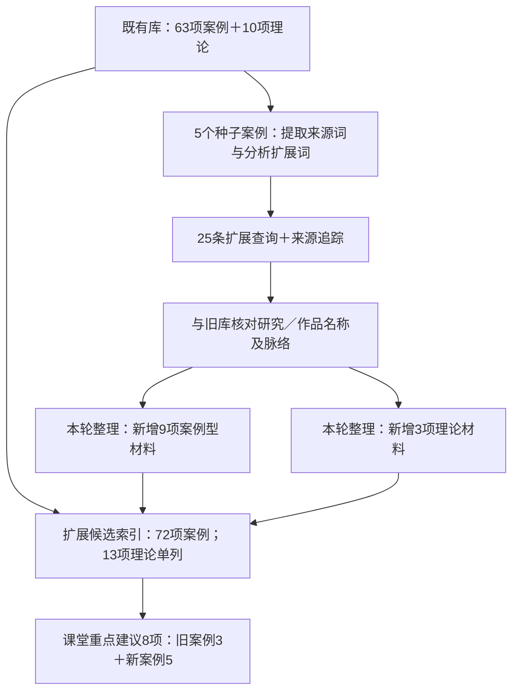

# 补充调研｜检索记录与筛选说明

**检索日期：2026年9月16日。**  
**方法：种子案例驱动的探索性网络检索、作者／作品脉络追踪、已知来源复核。**

## 一、检索范围与来源处理

从旧稿的Uninvited Guests、That’s Mine!、Our Friends Electric、CLARA及关机异议实验出发，提取角色、行为与冲突，再生成扩展词。

使用公开网页检索，追至作者网站、工作室官网、出版社、会议论文页、机构论文或作者预印本。ResearchGate和新闻报道用于发现线索；正式案例说明优先依据追溯到的原始材料。未进行Scopus、Web of Science等数据库的系统导出，未宣称覆盖其全部记录。

关键词查询共 **25条**；另有直接打开来源、页面内定位与版本核查，这些不额外算作关键词查询。以下逐条保留实际提交文本，不是事后拟写的“理想检索式”。一批的检索结果用于联合判断，未强行将每一条来源归因于唯一查询。

## 二、实际提交的25条查询

01. `robot disobedience principled refusal authority ownership Briggs Scheutz robots`

02. `Superflux Uninvited Guests elderly autonomy smart objects Eddi Our Friends Electric`

03. `robot consent dissent care robots paternalism refusal design`

04. `robot speculative design robot rights labour strike consent`

05. `"robot" "bystander" "privacy" consent robot design`

06. `"robot" "conflicting" "instructions" "authority"`

07. `"Addicted Products" Simone Rebaudengo toaster`

08. `"Ethical Things" automato farm`

09. `"intelligent disobedience" "elderly" 2023`

10. `robot bystander privacy consent non users HRI robot stop recording`

11. `robot relational consent continual consent design HRI`

12. `robot civil disobedience conscientious objection design`

13. `Lauren McCarthy LAUREN SOMEONE smart home human assistant`

14. `"robot" "bystanders" "privacy" "gestures"`

15. `"robot" "consent" "revocable"`

16. `"Sorry, I Can’t Do That" Briggs Scheutz 2015`

17. `"robot" "contestability" design`

18. `机器人 拒绝 服从 照护 自主权 思辨设计`

19. `"Dunne" "Robots" "neurotic"`

20. `"robot" "bystander" "privacy" "Opt"`

21. `"robot" "privacy" "Do Not" bystanders`

22. `"Technological Dreams Series" site:dunneandraby.co.uk`

23. `"robot" "consent" "permission" multi-party household`

24. `"It’s like a pet" "robot" privacy 2026`

25. `"Rules for Robots" "Co-Designing"`

## 三、检索批次及调整依据

| 查询编号 | 检索目的 | 结果如何影响下一步 |
| --- | --- | --- |
| 01—04 | 服从、照护、自主和艺术实践的初步扩展 | 出现家长式干预、照护机构的不服从方案、NIKA等线索；宽泛机器人权利查询混入大量论坛结果 |
| 05—09 | 物品归属扩展到多方权限，并沿作者追踪智能物件 | Ethical Things可追到作者；Addicted Products经核对属于旧C43，不重复计数 |
| 10—13 | 旁观者、持续同意、反抗与幕后劳动 | 发现同意理论、手持机器人立场论文、LAUREN；SOMEONE和旁观者综述属于旧库 |
| 14—19 | 具体拒绝机制、可质疑性、中文补充与Dunne & Raby | 找到2015拒绝机制原文及帮助适当性研究；中文查询未形成独立纳入条目 |
| 20—23 | 从泛泛隐私收紧至家庭、访客、照护空间 | 找到遥在机器人实地研究、老人隐私共创、多成员家庭研究等线索 |
| 24—25 | 对共创与家庭研究作精确标题追踪 | 找到会议官方条目与预印本标识；核对作者、方法和版本后整理N08、N09 |

个别宽泛查询没有提供适合本题的独立新材料。不能因为执行过查询，就把无关结果也加入案例库。

## 四、来源核查路径与限制

| 条目／组别 | 追溯路径与本次处理 |
| --- | --- |
| 五个种子案例 | 沿旧稿链接重新分析检索词；本轮重开C45、C14、C08和查阅C42项目说明；C16研究信息沿用前轮已核查记录，本轮不声称重做全文评价 |
| N01、N02 | 追到作者官网；LAUREN不使用百科转述替代作者材料 |
| N03 | 追到AAAI会议PDF，读取角色与规范许可相关段落 |
| N04 | arXiv HTML入口未成功获取，改查同一研究的公开PDF；没有因此省略证据类型说明 |
| N05 | 读取原论文的概念情境与修订设计，分清作者讨论和实施结果 |
| N06 | 查看出版页面摘要与理论讨论，不补写未核对的效应量 |
| N07 | 查原论文的研究设置和公共空间讨论 |
| N08 | 用会议官方目录与公开PDF交叉核对；PDF中的DOI占位符不抄入文献标识 |
| N09 | 由发现入口追至arXiv摘要和HTML；按所查v1预印本表述 |
| NT01—NT03 | 单列理论／立场文献，阅读深度见证据附录 |
| 旧T04、T10 | 标为重复命中／重新启用，不再增加文献数 |

## 五、目录计数与筛选流程

本轮采用与旧库衔接的“命名研究／作品”目录口径：

- 旧案例库63项；新增N01—N09共9项；扩展候选索引合计72项。
- 旧理论库10项；新增NT01—NT03共3项；理论索引合计13项。
- 旧T04及T10再次命中，已识别为旧条目，不计入新增。
- N02 LAUREN与旧C44 SOMEONE是同作者不同命名作品；N03与旧C01、T03共享研究脉络。目录可以分列，不能据此声称证据相互独立。
- 9项新增中，建议N01、N05、N07、N08、N09共5项进入课堂重点比较，另4项保留为支持或对照。
- 旧库选出C14、C42、C45共3项，与上述5项组成建议的8项重点材料。八项并不是八项技术验证。

**这张图是补充检索与整理路径，不是完整PRISMA文献流量图。** 搜索引擎原始网页命中数、不同查询间的全部重复网页数、所有标题摘要排除数没有逐条建立计数，保持“未统计”，不能用25条查询或12项新材料代替这些数字。旧稿63→18→12的流程仍表示上轮筛选，不与本轮相加冒充一次完整系统综述。

## 六、纳入与保留的判断规则

优先纳入重点比较的材料须：

1. 能具体说明谁提出要求、谁受到影响，或谁能够修改边界。
2. 有可追溯原始来源，能辨认真实研究、设计情境和虚构作品。
3. 为四类分析增加不同关系视角，避免只重复“机器人会拒绝”。
4. 能交代反馈落在当前任务、后续策略、人类设计修改还是作品叙事。
5. 适合与家庭照护主问题比较，即使作为反例也要说清作用。

处理其他搜索命中：

- 论坛想象、百科、汇总博客：不作为本轮结论的原始证据。
- 宽泛机器人权利论辩、战争机器人：与当前日常照护情境距离较远，未扩大为正文主线。
- 其他新近家庭隐私论文、商业产品与未充分核查项目：暂不加入本轮正式条目，也不声称其无价值。
- 科幻仍作为兴趣来源，不当作现实能力与社会效果的验证。

## 七、方法边界与可复核性

这是一次有目的的补充检索与代表性整理。没有宣称检索饱和，也没有完成所有候选的全文质量评价。网页摘要与正文节选可以支持概念分析，但不能支持没有阅读到的实验细节。

当前为AI辅助整理，未进行第二位独立筛选者复核。未运行LDA；四类分组依据关系问题和材料内容，是本研究的分析框架。

本次只新增Markdown汇总、证据附录与查询记录。原有研究库和旧版作业保留，便于对照老师反馈前后的变化。

