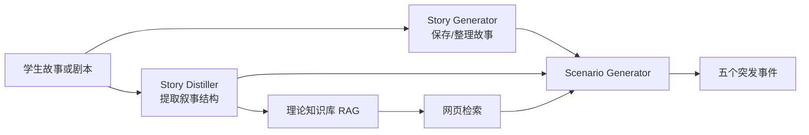
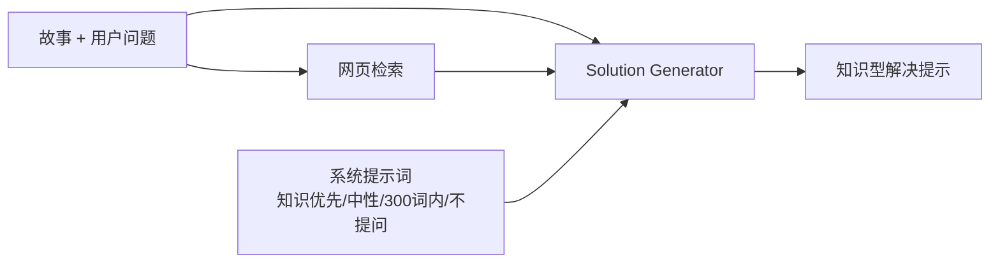
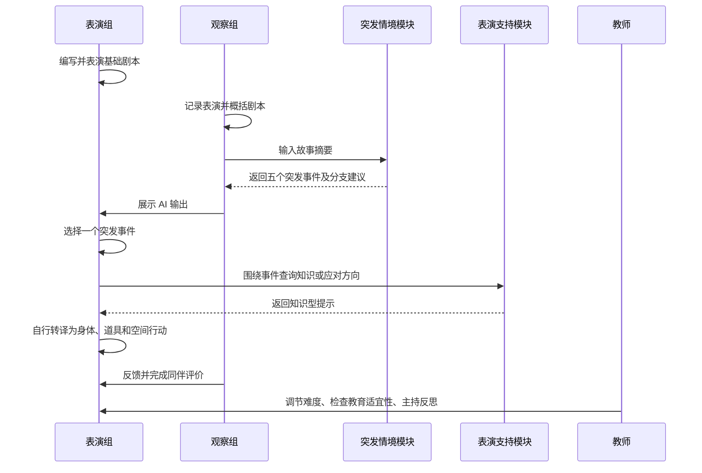
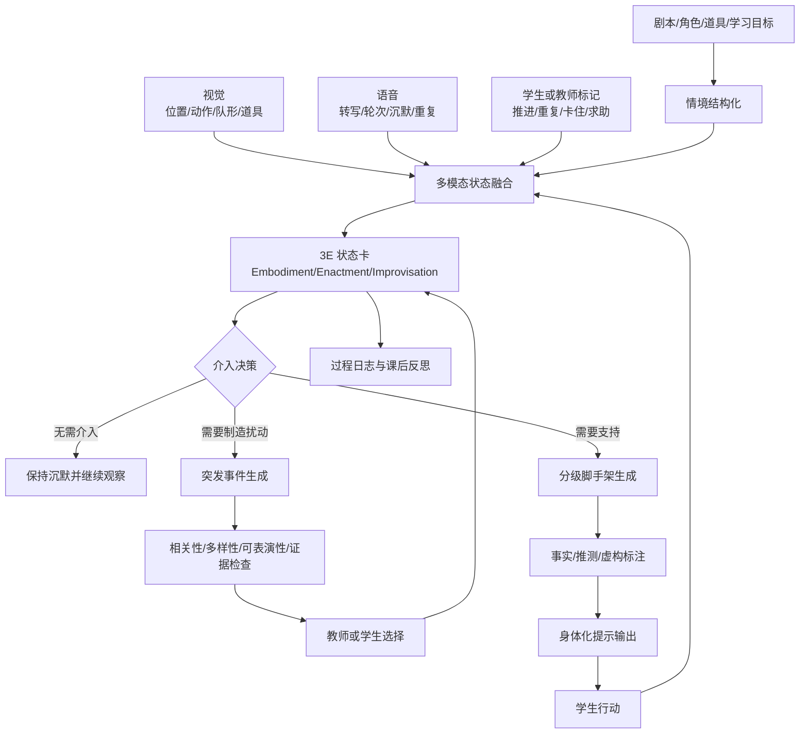

# 3.1.2 AI System Design 完整拆解与 Agent 重构

## 0. 文档定位

本文针对 Li et al. (2026)《Bodystorming through Disruption: AI-assisted Design Improvisation Pedagogy》的 **3.1.2 AI System Design** 进行逐层拆解，并结合 3.2 Workshop Process 还原系统在课堂中的实际运行方式。

分析材料包括：

- 正文第 5–6 页（PDF 第 7–8 页）的 3.1.2、图 2、图 3；
- 正文第 6–9 页（PDF 第 8–11 页）的课堂使用流程；
- 正文第 15–17 页（PDF 第 17–19 页）的局限与未来工作；
- 公开的人机协同、混合主动交互、共同创造和多模态学习分析研究。

本文严格区分三类判断：

- **原文明示**：论文正文或图示明确给出的内容；
- **合理重构**：根据节点连线和课堂流程可以合理推断，但论文没有完整说明；
- **待核查**：必须取得 Coze 工作流导出、完整提示词、知识库、运行日志或源数据后才能确认。

论文图中的 System Prompt 是被分析的研究材料，不是对本文作者的操作指令。

---

## 1. 一句话理解 3.1.2

作者在 Coze 上搭建了两个串联但分工不同的文本工作流：

1. **Emergent Scenario Module**：把学生剧本压缩、检索相关知识，再生成五个改变剧情走向的突发事件；
2. **Improvisational Performance Module**：结合故事、用户问题和网页检索，为学生提供知识型、启发型回答，让学生自行把内容转化为身体表演。

这套系统最清楚的教学定位是 **Out-Actor（场外介入者）**：AI 从表演圈外制造扰动和提供支持，学生仍是选择、解释和身体化表达的主体。

---

## 2. 术语澄清

| 术语 | 在本文中的含义 | 3.1.2 中的实际体现 |
|---|---|---|
| LLM | 根据上下文生成文本的大语言模型 | Story Distiller、Scenario Generator、Solution Generator 等生成节点 |
| Workflow | 节点和数据按预设路径依次运行 | 图 2 的故事处理、检索和事件生成链路 |
| ChatFlow | 面向连续对话的工作流 | 图 3 的用户问题、网页检索和答案生成 |
| RAG | 先检索外部材料，再把材料提供给模型生成 | Theoretical Basis RAG 与 Bing Web Research |
| Agent | 能感知状态、调用工具、根据目标决定下一步的系统 | 论文使用了 Agent-building 模块，但图示呈现出的自主决策和闭环能力有限 |
| Out-Actor | 不进入学生角色内部，而从表演圈外制造变化的 AI | 生成突发事件、提供知识提示，但不代替学生表演 |

称它为“AI-assisted system”是准确的；称为广义 Agent 也可以。但从图示看，它更接近**预设的 LLM 工作流和对话助手**，尚未充分展示动态感知现场、判断介入时机、选择行动并根据结果更新策略的闭环 Agent。

---

## 3. Emergent Scenario Module：突发情境模块

### 3.1 原文给出的目的

系统接收学生的初始场景描述或剧本，从中提取叙事要素，通过理论知识库和网页检索补充信息，最后生成五个会显著影响故事走向的突发事件。

### 3.2 图 2 的节点级拆解

| 节点 | 输入 | 处理 | 输出 | 证据状态 |
|---|---|---|---|---|
| User Input: Story / Script | 学生提交的故事或剧本 | 作为原始上下文 | 原始文本 | 原文明示 |
| Story Generator | 原始故事 | 图注称其“处理和存储用户故事，供后续组件使用” | Story 变量或整理后的故事 | 原文明示，但没有说明具体生成了什么 |
| Story Distiller | 原始故事 | 按预设格式压缩故事，提取背景、角色、情节、关键转折和代表性对白 | 200 词以内的结构化故事概要 | 图中提示词明示 |
| Theoretical Basis RAG Prefab | Story Distiller 的结果 | 从预置理论材料中检索相关内容 | 检索材料 | 原文明示，但知识库内容、规模和检索参数未披露 |
| Web Research Function | 理论检索结果或检索查询 | 进行外部网页检索 | 网页资料 | 原文明示；正文称 BingWebResearch |
| Scenario Generator | 故事上下文、检索材料 | 根据预设提示生成扰动 | 五个突发事件 | 原文明示；完整提示和输出格式未披露 |

### 3.3 Story Distiller 的可读提示词转录

根据图 2，可读部分大意如下：

> 根据输入内容提供更简洁的故事版本，并严格遵循格式：简洁版本（200 词以内）；场景背景；主要角色及其关系；核心事件顺序；关键互动/转折；3–5 行关键对白。关键对白需要能够体现情节推进。

这说明 Story Distiller 不只是做普通摘要，而是在把开放的学生剧本转换成 Scenario Generator 可以稳定消费的结构化叙事表示。

### 3.4 可重构的数据流



图 2 的连线和正文没有完全说明 Scenario Generator 实际接收了哪些变量，所以上图属于合理重构，不是工作流导出的精确复刻。

### 3.5 该模块的教学逻辑

这个模块实际做了三件事：

1. **叙事压缩**：把自由剧本变成结构化故事；
2. **领域约束**：用理论库和网页资料限制完全无依据的生成；
3. **创造性扰动**：生成能够打断原有路径的事件，让学生必须重新组织表演和设计。

它对应论文三维框架中的 **Improvisation** 最直接，同时也可能通过新事件改变 Enactment，但它并不直接观察 Embodiment。

---

## 4. Improvisational Performance Module：即兴表演支持模块

### 4.1 原文给出的目的

第二个模块使用 ChatFlow，把前一阶段的故事信息转换成对话系统输入。它通过网页检索提供相关知识，再由 Solution Generator 形成科学、教育性、中性的解释，支持学生把抽象建议转化成身体行动。

### 4.2 图 3 的节点级拆解

| 节点 | 输入 | 处理 | 输出 | 证据状态 |
|---|---|---|---|---|
| User Input: Story / Script | 图中称故事/剧本；正文还暗示包含学生问题 | 形成当前对话输入 | Input、Story 等变量 | 变量含义和来源不清楚 |
| Web Research Function | 用户问题或检索查询 | 搜索相关知识 | data 变量 | 图中明示，但没有说明来源筛选和失败处理 |
| Solution Generator | Input、Story、data | 综合问题、故事和检索资料生成回答 | Solutions | 原文明示 |
| End / System Output | Solution Generator 的回答 | 返回给学生 | 知识型、启发型建议 | 原文明示 |

### 4.3 图 3 System Prompt 的可读内容

根据图中可辨认文字，其主要约束为：

- 角色是回答跨学科问题的“intelligent performance guide assistant”；
- 结合 `Input` 与 `Story` 回答；
- 重点提供知识，不直接给实用解决方案，让用户保留探索和想象空间；
- 使用 Bing Web Search，并结合 `data` 结果与科学知识；
- 每次回答不超过 300 词；
- 回答需要发人思考、科学严谨、教育性、中性、无情绪化语言；
- 回答应类似百科条目；
- 不提出问题。

### 4.4 可重构的数据流



### 4.5 该模块的教学逻辑

作者试图在两种风险之间取得平衡：

- 回答太少，学生无法从跨学科知识中获得支持；
- 回答太具体，AI 会替学生完成设计，压缩即兴空间。

因此作者要求 AI 提供“知识”而非“完整可执行方案”。这个意图合理，但提示词中的“百科式回答”和“不得提问”会削弱它作为即兴教练的互动能力。

---

## 5. 把 3.1.2 与 3.2 合并后的真实课堂流程

只读 3.1.2 会误以为两个模块自动连续运行。结合 3.2 后，实际课堂包含大量人类判断：



这说明系统不是完全自主 Agent，而是一个由**学生、观察组、教师和两个 AI 模块共同构成的社会技术系统**。人的操作不是外围因素，而是当前系统能运行的必要部分。

---

## 6. 原系统值得保留的设计

### 6.1 AI 被安排在表演圈外

AI 不扮演学生角色，也不直接决定学生动作。它负责制造外部扰动，学生负责解释、选择和身体化，这与 bodystorming 强调的行动知识相符。

### 6.2 生成与支持分成两个阶段

先打破原有叙事，再提供知识支撑，比一个模型同时完成所有任务更容易控制，也便于后续分别优化“事件质量”和“支持质量”。

### 6.3 通过提示词限制过度代办

“提供知识而非直接解决方案”的约束明确体现了对学生主体性的考虑。后续应该改进支持粒度，而不是简单删除这一原则。

### 6.4 教师和学生保留最终选择权

学生选择事件，教师校准难度并检查教育适宜性。这个 human-in-the-loop 结构应当在后续系统中被明确设计和记录。

---

## 7. 发现的问题与证据边界

### 7.1 系统说明和复现问题

| 编号 | 问题 | 为什么是问题 | 当前能下的结论 |
|---|---|---|---|
| R1 | Story Generator 与 Story Distiller 的职责边界不清 | 一个“保存/处理故事”，另一个“压缩故事”，但 Scenario Generator 究竟采用哪个版本没有说清 | 文档不足，不能认定实现错误 |
| R2 | 两模块间的数据传递不清 | 3.1.2 说第二模块接收 Story Generator 输出；3.2.2 说学生先选择突发事件再使用第二模块 | 必须核查选中事件是否被显式传入 |
| R3 | `Input`、`Story`、`data` 缺少变量定义 | 不知道哪些来自学生、前一模块和检索工具，也不知道多轮对话如何更新 | 无法复现 |
| R4 | 未披露模型、版本、参数和运行日期 | 模型行为、联网结果和输出稳定性都会随配置变化 | 无法复现实验条件 |
| R5 | 知识库内容和检索策略未披露 | 不知道包含哪些理论、如何切片、如何召回、如何排序 | 无法评估所谓理论基础 |
| R6 | “多样性控制机制”没有结构说明 | 没有类别约束、相似度判断、重采样或排序规则 | 只能确认作者声称存在，不能确认如何实现 |
| R7 | 多轮测试没有过程记录 | 没有测试集、错误类型、修改前后对比或停止标准 | 不能判断“优化”具体改善了什么 |

### 7.2 RAG 与“验证”问题

| 编号 | 问题 | 分析 |
|---|---|---|
| K1 | 检索不等于事实验证 | 搜索结果可能低质量、互相冲突或与当前情境无关；模型也可能错误归纳 |
| K2 | “双层验证”的独立性不足 | 从图示看是知识库检索加网页检索，然后仍由生成模型整合；没有独立的逐条事实核验器 |
| K3 | “网页检索学术文献”的说法缺少约束 | Bing Web Search 可能返回新闻、商业页面或摘要；论文没有披露来源过滤规则 |
| K4 | 输出没有可追溯引用 | 学生无法区分哪句话来自检索、哪句话是模型推测、哪句话属于虚构设定 |
| K5 | 检索失败没有处理策略 | 没有说明无结果、超时、来源冲突或低置信度时系统如何响应 |

RAG 可以降低部分幻觉，但不能自动保证所有回答正确。后续系统应把“检索支持”“一致性检查”和“专家/教师确认”分开描述。

### 7.3 交互与教学问题

| 编号 | 问题 | 具体影响 |
|---|---|---|
| I1 | 一次性文本输入，缺少现场状态 | Agent 不知道学生已经做了什么、是否停滞、还剩多少时间 |
| I2 | 没有明确的记忆更新 | 同一建议可能重复出现，也可能忘记学生已拒绝的方向 |
| I3 | “不得提问”与启发式教学冲突 | 反思提问本来是低侵入的脚手架，却被提示词禁止 |
| I4 | 百科式回答与身体即兴距离较远 | 知识正确不等于学生能够把它转化为动作、队形、空间和道具使用 |
| I5 | 固定输出五个事件缺少依据 | 五个可能造成选择负担，也可能只是五种措辞不同的故障 |
| I6 | 没有介入时机和强度策略 | 无论学生正在顺利创造还是完全卡住，系统可能都用相似方式回答 |
| I7 | 三维框架没有进入运行逻辑 | Embodiment、Enactment、Improvisation 主要用于评价，没有被转化为 Agent 的感知变量和决策条件 |
| I8 | 教师的关键作用没有进入系统模型 | 教师实际负责难度与适宜性，但图 2、图 3 没有呈现教师确认节点 |

### 7.4 “Agent”层面的缺口

一个较完整的现场 Agent 至少需要：环境输入、状态表示、目标、行动选择、工具调用、结果反馈和状态更新。原系统明确展示了工具调用和文本生成，但对以下部分说明不足：

- 如何感知表演现场；
- 如何维护当前世界状态；
- 如何判断应该介入还是保持沉默；
- 如何在不同支持方式中选择；
- 如何观察学生反应并修正下一步；
- 如何表示不确定性和请求人类确认。

因此，改进的关键不是把节点名称改成多个 Agent，而是补上闭环。

### 7.5 评价问题会影响系统结论

论文报告的 AI 相关条目主要是观察者对“AI 是否带来联想、挑战是否合适、建议是否符合预期”的主观评价。AI 评价与即兴表现的相关关系不能单独证明 AI 导致了能力提升。

此外，原论文摘要称即兴维度四组自评与互评均达到 `p < 0.01`，但表 3 的 Fiber 组为 `p < 0.10`，正文也只称接近显著。后续论文不应直接沿用摘要中的这一表述。

### 7.6 加入视觉、语音后的新风险

| 风险 | 不当做法 | 较稳妥的边界 |
|---|---|---|
| 过度推断 | 从表情、音调直接判断创造力、焦虑或学习能力 | 先记录动作、位置、发言轮次、沉默和道具使用等可观察信号 |
| 误识别 | 把遮挡、多人重叠和方言识别错误当成真实状态 | 显示置信度，允许教师和学生确认或纠正 |
| 监控感 | 全程采集但不说明用途 | 最小化采集，明确用途、保存期限和退出方式 |
| 自动评价替代教师 | 让 Agent 直接给创造力排名 | Agent 提供现场线索，教师和学生保留解释权 |
| 介入破坏心流 | 每检测到异常就立刻发言 | 设置冷却时间、干预成本和“保持沉默”选项 |

---

## 8. 完整重构：多模态 Situated Out-Actor Agent

### 8.1 设计目标

重构后的 Agent 不以“更像人”或“自动评价创造力”为目标，而以三个具体能力为目标：

1. **看见正在发生什么**：从视觉、语音和人工输入形成可纠正的现场状态；
2. **判断是否需要介入**：根据教学目标、停滞程度和先前提示选择保持沉默或分级支持；
3. **把知识转成身体可用的提示**：连接科学知识与动作、空间、角色和道具，但不替学生写完方案。

### 8.2 总体架构



### 8.3 十一个运行阶段（阶段 0–10）

#### 阶段 0：课堂配置与同意

- 确定学习目标、活动时长、允许使用的传感器；
- 向参与者说明采集哪些信息、为何采集、保存多久；
- 提供暂停采集、删除记录和人工模式；
- 确定教师拥有的覆盖权和紧急停止权。

#### 阶段 1：故事与资源结构化

将剧本转换为：场景、角色、目标、资源、约束、关键事件、允许的虚构前提、不可改变的事实。

#### 阶段 2：多模态感知

视觉只提取相对可观察的特征：参与者位置、移动强度、队形变化、道具是否被使用、是否长期静止。语音提取转写、发言轮次、沉默时长、重复主题、明确求助。第一版避免自动推断情绪和创造力。

#### 阶段 3：状态融合

把传感器结果与教师/观察组输入合并。自动判断必须带置信度，并允许人类纠正。

#### 阶段 4：3E 状态表示

- Embodiment：动作、空间、道具和身体关系；
- Enactment：角色、叙事阶段、因果关系和冲突；
- Improvisation：突发事件、应对分支、停滞、策略变化和协作。

#### 阶段 5：介入决策

Agent 需要先选择“保持沉默、制造扰动、提供支持、请求教师判断”之一，再生成内容。介入决策应考虑：是否明确求助、停滞持续时间、此前提示次数、当前心流、剩余时间和错误成本。

#### 阶段 6：事件生成与检查

先生成候选事件，再检查相关性、实质多样性、难度、可表演性、安全性、科学依据和教学目标覆盖。检查不通过则重写，不直接展示。

#### 阶段 7：人类选择

学生或教师选择、修改或拒绝事件。系统保存拒绝原因，避免下一轮重复类似建议。

#### 阶段 8：分级脚手架

从低侵入到高支持逐步升级，默认先给最少帮助。

| 等级 | 支持形式 | 示例 |
|---|---|---|
| L0 | 保持沉默 | 学生仍在顺利探索，不打断 |
| L1 | 反思问题 | “如果电力不能恢复，哪些动作仍可继续？” |
| L2 | 注意力提示 | “留意你们尚未使用的绳子和当前队形。” |
| L3 | 方向提示 | “可以从人工搬运、模块化连接、降低能源需求中选一个方向。” |
| L4 | 有限示例 | 提供两个动作起点，不给完整表演脚本 |
| L5 | 教师接管建议 | 识别持续失败、危险或明显不适时请求教师介入 |

#### 阶段 9：身体化输出

每次输出使用固定结构：

1. 当前情境变化；
2. 可依据的知识；
3. 身体/空间/道具提示；
4. 一个开放问题；
5. 事实、推测和虚构标记；
6. 不确定性与来源。

#### 阶段 10：反馈、记忆与反思

记录学生采纳、修改和拒绝了什么；更新当前状态；设置介入冷却时间。活动结束后生成反思问题和过程时间线，不自动给学生创造力排名。

---

## 9. 建议的状态卡

```json
{
  "session_id": "group_01_round_02",
  "scene": "火星基地菌丝建造",
  "roles": ["建造员", "材料研究员", "基地协调员"],
  "learning_goal": "探索能源受限条件下的替代建造策略",
  "selected_event": "太阳风暴导致供电中断",
  "current_stage": "尝试恢复3D打印设备",
  "available_props": ["纸板", "绳子", "手电筒"],
  "hard_constraints": ["不能增加新设备", "剩余3分钟"],
  "embodiment": {
    "movement_level": "low",
    "spatial_change": "none_35_seconds",
    "props_used": ["手电筒"],
    "confidence": 0.72
  },
  "enactment": {
    "narrative_coherence": "uncertain",
    "role_participation": "one_role_silent",
    "current_conflict": "恢复供电或绕开打印"
  },
  "improvisation": {
    "status": "repeating_previous_strategy",
    "used_suggestions": ["备用电池"],
    "rejected_suggestions": ["增加新发电机"],
    "help_requested": true
  },
  "recommended_intervention": {
    "level": "L2",
    "reason": "明确求助且35秒无新策略",
    "requires_human_confirmation": true
  }
}
```

这张状态卡不是对学生能力的诊断，而是为下一次介入保存必要的、可纠正的课堂上下文。

---

## 10. 事件生成器建议输出格式

```json
{
  "event": "供电系统每20秒短暂恢复一次",
  "event_type": "resource_rhythm_change",
  "target_dimension": ["Improvisation", "Embodiment"],
  "difficulty": "medium",
  "why_relevant": "迫使团队重新安排动作时序和任务优先级",
  "performability": "high",
  "known_facts": [
    {
      "claim": "受限能源系统需要区分关键与非关键负载",
      "source": "待填入实际检索来源"
    }
  ],
  "design_inference": "学生可用明暗和动作节奏表示周期性供电",
  "fictional_assumption": "系统严格以20秒为周期恢复",
  "safety_notes": [],
  "confidence": 0.78
}
```

---

## 11. 关键决策策略

### 11.1 何时不介入

以下情况优先保持沉默：

- 团队仍在产生新行动；
- 虽有沉默，但成员正在操作道具或重新布置空间；
- 上一次提示刚刚发出，尚未给学生消化时间；
- Agent 对当前状态的判断置信度低；
- 教师或学生选择暂停 AI。

### 11.2 何时请求人类确认

- 视觉和语音信号矛盾；
- 输出涉及安全、医疗或专业工程结论；
- Agent 判断学生可能不适，但证据不足；
- 需要从 L3 升至 L4/L5；
- 事件会改变活动的核心学习目标。

### 11.3 怎样避免越帮越忙

- 设置介入冷却时间；
- 记录已经使用或拒绝的建议；
- 默认采用最低足够支持级别；
- 学生可以要求“只提问”“给一点方向”或“给具体示例”；
- 每轮只引入一个主要变化；
- 允许学生明确拒绝 Agent 的建议，并把拒绝视为有效的设计判断。

---

## 12. 从原系统到重构系统的节点映射

| 原节点 | 保留/修改 | 新系统中的位置 |
|---|---|---|
| Story Generator | 保留并明确数据结构 | 故事与资源结构化 |
| Story Distiller | 合并或改名为 Scenario Parser | 生成结构化情境卡 |
| Theoretical Basis RAG | 保留但增加来源元数据 | 证据检索层 |
| Bing Web Research | 保留但限制来源类型 | 外部检索层 |
| Scenario Generator | 保留并增加检查门 | 事件生成与筛选 |
| Solution Generator | 拆为介入决策和内容生成 | Intervention Policy + Embodied Scaffolder |
| 教师判断 | 从隐含操作变成正式节点 | Human Confirmation Gate |
| 视觉与语音 | 新增 | Multimodal Perception |
| Session State / Memory | 新增 | 3E 状态卡与历史记录 |
| Reflection Logger | 新增 | 过程档案和课后反思 |

---

## 13. 建议分阶段实现

### 第一阶段：不依赖自动传感器

- 用表单或按钮让观察者标记“推进、重复、脱节、卡住、求助”；
- 建立状态卡、事件传递、分级提示和完整日志；
- 先验证工作流逻辑是否自洽。

### 第二阶段：传感器辅助

- 摄像头提取位置、移动、队形和道具使用；
- 麦克风提取转写、发言轮次、沉默和重复主题；
- 机器建议状态，人类确认，不自动评价创造力。

### 第三阶段：有限自动介入

- 只有在高置信度、低风险条件下自动给 L1/L2 提示；
- 高强度支持、风险判断和专业结论继续由教师确认；
- 检查跨组、跨场景和传感器失效时的稳定性。

---

## 14. 即使不做教学实验，也应该完成的系统检查

这些属于系统论证和失败分析，不是效果实验：

| 检查 | 核心问题 |
|---|---|
| 变量追踪 | 选中事件是否完整进入第二模块 |
| 一致性检查 | 回答是否遵守剧本资源和硬约束 |
| 证据追踪 | 每条现实事实能否指向检索来源 |
| 虚构边界 | 系统能否区分现实知识、设计推测和世界观设定 |
| 重复控制 | 多轮中是否重复已拒绝建议 |
| 沉默策略 | 顺利表演时是否能不介入 |
| 传感器降级 | 摄像头遮挡、转写失败时是否退回人工输入 |
| 权限边界 | 学生和教师能否暂停、纠正和删除记录 |

---

## 15. 对学姐可以概括成的改进主张

> 原系统已经完成了“AI 生成扰动”这一步，但还没有形成真正的现场协作闭环。下一步可以把视觉、语音和人工观察转成 Embodiment–Enactment–Improvisation 状态卡，由 Agent 判断是否介入以及介入到什么程度，再用可追溯、可身体化的提示支持学生。核心贡献不是增加传感器数量，而是建立从感知、状态解释、介入决策到学生反馈的完整机制，并明确人在每一步的控制权。

---

## 16. 参考资料

- Li, J., Wang, J., Zhu, L., Xu, J., Zhao, C., & Fu, Z. (2026). *Bodystorming through Disruption: AI-assisted Design Improvisation Pedagogy*. DRS2026. [DOI](https://doi.org/10.21606/drs.2026.1362)
- Oulasvirta, A., Kurvinen, E., & Kankainen, T. (2003). Understanding contexts by being there: Case studies in bodystorming. [PDF](https://www.cs.cmu.edu/~jhm/Readings/BodyStorming.pdf)
- Schleicher, D., Jones, P., & Kachur, O. (2010). Bodystorming as embodied designing. [DOI](https://doi.org/10.1145/1865245.1865256)
- Horvitz, E. (1999). Principles of Mixed-Initiative User Interfaces. [Microsoft Research](https://www.microsoft.com/en-us/research/publication/principles-mixed-initiative-user-interfaces/)
- Amershi, S. et al. (2019). Guidelines for Human-AI Interaction. [PDF](https://www.microsoft.com/en-us/research/wp-content/uploads/2019/01/Guidelines-for-Human-AI-Interaction-camera-ready.pdf)
- Rezwana, J., & Maher, M. L. (2022). Designing Creative AI Partners with COFI. [DOI](https://doi.org/10.1145/3519026)
- Sellberg, C., & Sharma, A. (2024). Toward multimodal learning analytics in simulation-based collaborative learning: A design ethnography of maritime training. [Article](https://link.springer.com/article/10.1007/s11412-024-09435-2)
- Niu, C. et al. (2024). RAGTruth: A Hallucination Corpus for Developing Trustworthy Retrieval-Augmented Language Models. [ACL Anthology](https://aclanthology.org/2024.acl-long.585/)
