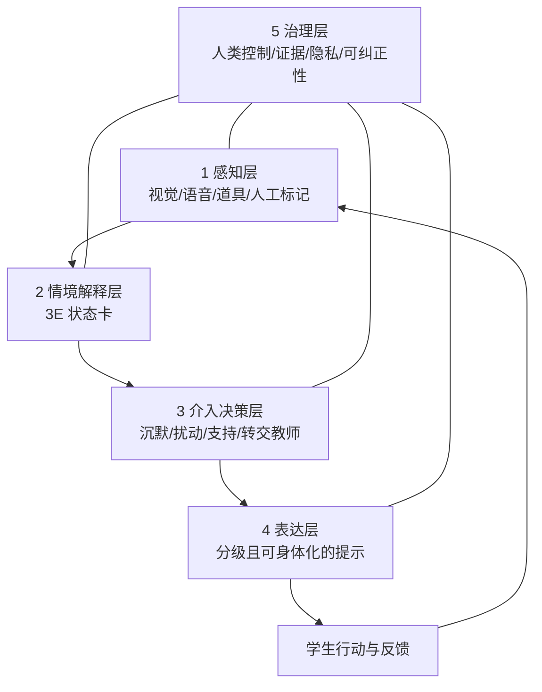

# 多模态 Situated Out-Actor 概念论文 Idea

## 0. 先说结论

如果暂时不做实验，最可行的文章不是“证明新 Agent 有效”，而是写成一篇**概念框架与设计论证型论文**：从原论文的文本式 Out-Actor 出发，综合 bodystorming、具身认知、混合主动交互、人机共同创造和多模态学习分析，提出一个面向物理设计即兴的多模态 Agent 框架、设计命题、运行流程和伦理边界。

文章可以提出、分析和演示框架，但不能使用“验证了”“显著提升”“证明有效”等效果性表述。若目标期刊只接受实证研究，则这个形式可能不匹配；应在确定期刊后检查文章类型和作者指南。

---

## 1. 推荐的核心选题

### 中文题目候选

1. **从场外扰动到情境协作：面向 Bodystorming 的多模态 Situated Out-Actor Agent 框架**
2. **感知何时介入：具身设计即兴中的多模态 AI 脚手架框架**
3. **将 Embodiment–Enactment–Improvisation 转化为运行模型：具身共同创造 Agent 的概念框架**

### 英文题目候选

1. **From Out-Actor to Situated Co-Improviser: A Multimodal Agent Framework for Bodystorming**
2. **Sensing When to Intervene: A Mixed-Initiative AI Framework for Embodied Design Improvisation**
3. **Operationalizing Embodiment, Enactment, and Improvisation for Situated Human–AI Co-Creation**

推荐第 2 个英文题目，因为它把真正的研究难点落在了 **when to intervene**，比“用了视觉和语音”更有理论和设计价值。

---

## 2. 30 秒论文摘要式 Pitch

现有生成式 AI 支持设计即兴时，通常依据文本描述提供一次性情境或建议，无法感知参与者在物理空间中的动作、对话和协作变化。本文提出一个面向 bodystorming 的多模态 Situated Out-Actor 框架，把视觉、语音和人类标记转化为 Embodiment–Enactment–Improvisation 状态，并通过混合主动介入策略决定何时保持沉默、何时制造扰动、何时提供分级脚手架。该框架将 AI 从文本内容生成器重新定义为受人类控制的情境协作者，同时通过事实/推测/虚构分层、可纠正状态和传感器治理保护创作自主性。文章以系统重构、跨领域概念综合、情境走查和失败模式分析论证框架，不对学习效果作未经验证的主张。

---

## 3. 论文要抓住的理论缺口

### 3.1 原论文已经完成了什么

- 把 AI 放在表演圈外，提出 Out-Actor 角色；
- 用突发事件打断学生习惯路径；
- 将 Embodiment、Enactment、Improvisation 用作能力与表现维度；
- 通过 RAG 和提示词控制内容；
- 由学生选择和身体化 AI 生成内容。

### 3.2 仍缺少什么

- Agent 不知道现场正在发生什么；
- 3E 框架主要用于活动设计和评价，没有成为系统的实时状态表示；
- 系统没有理论化“何时介入、介入多少、何时沉默”；
- 视觉、语音等多模态信号没有与教学行动建立明确映射；
- AI 的感知、解释和建议可能侵蚀隐私与创作自主性，但缺少治理框架；
- RAG、科学事实和设计虚构之间的边界不清。

### 3.3 真正的研究空白

文章不应把空白写成“目前没人把摄像头接到 LLM”。这很容易被已有多模态系统覆盖，也缺少设计理论价值。

更准确的表述是：

> 在开放、具身、共同创造的设计即兴中，仍缺少一种把可观察的身体与对话状态转化为低侵入、可协商、保留人类主动权的 AI 介入机制。现有研究分别讨论了 bodystorming、共同创造、多模态学习分析和混合主动交互，但这些知识尚未被整合为适用于现场设计即兴的 Agent 框架。

这个 gap 需要经过正式文献检索后才能最终确认，不能仅凭当前阅读直接声称是全球首创。

---

## 4. 研究问题

不做实验时，研究问题应该是概念性和设计性的：

### RQ1

**如何把 Embodiment、Enactment 和 Improvisation 从事后评价维度转化为多模态 Agent 可维护、可纠正的现场状态表示？**

### RQ2

**在 bodystorming 中，Agent 应依据哪些现场状态决定保持沉默、制造扰动、提出问题或提供更具体的支持？**

### RQ3

**如何设计人类控制、证据透明和传感器治理机制，使多模态 Agent 支持即兴而不替代学生的创作判断？**

可选的第四问：

**如何区分科学事实、基于事实的设计推测和设计虚构，使 RAG 支持思辨创造而不制造错误权威？**

前三问已经足够构成一篇完整文章。第四问可以作为框架中的知识治理部分，避免主题过宽。

---

## 5. 核心概念：Situated Out-Actor

### 5.1 定义

**Situated Out-Actor** 是一种位于表演角色之外、通过有限多模态感知理解当前情境、以混合主动方式选择介入时机和支持强度、并始终允许参与者修正或拒绝其判断的 AI 协作者。

它有四个必要条件：

1. **Situated**：建议来自当前空间、动作、对话、资源和历史，而不只来自初始剧本；
2. **Out-Actor**：Agent 不替代任何学生角色，不直接完成身体表演；
3. **Mixed-initiative**：AI、学生和教师都能发起、延迟、修改或拒绝介入；
4. **Reflective**：系统保存选择和拒绝过程，支持活动后的设计反思。

### 5.2 它不是什么

- 不是自动给学生创意分数的监控系统；
- 不是根据面部表情诊断情绪的识别系统；
- 不是替学生生成完整解决方案的自动设计师；
- 不是仅仅把视觉模型、语音模型和 LLM 串起来；
- 不是因为节点较多就自动成立的“多 Agent 系统”。

---

## 6. 论文提出的五层框架

### 第一层：感知

输入视觉、语音、道具或环境信号，同时保留教师和学生的主动标记。感知层只产生可观察特征，不直接给学生贴“没有创造力”“缺乏参与”等标签。

### 第二层：情境解释

把信号组织为 3E 状态卡：

- Embodiment：动作、空间、身体关系、道具；
- Enactment：角色、叙事阶段、情境因果、冲突；
- Improvisation：扰动、策略变化、停滞、重复、协作和求助。

关键主张是：3E 不再只是一张活动结束后的评价表，而成为 Agent 在运行时维护的**中间表示**。

### 第三层：介入决策

Agent 先决定是否介入，再决定说什么。可选行动包括：

- 保持沉默；
- 制造一个新扰动；
- 提出反思问题；
- 指向被忽视的身体、空间或道具；
- 提供知识方向；
- 提供有限示例；
- 请求教师判断。

### 第四层：表达

输出应当可被身体化，并区分知识、推测与虚构。表达方式不只包括文字，还可以是声音、灯光、空间提示或道具反馈，但每种输出都需要说明其教学作用。

### 第五层：治理

治理层贯穿前四层：数据最小化、告知与同意、置信度显示、纠正权、拒绝权、教师覆盖权、来源追踪、保存期限和退出机制。

---

## 7. 从传感器到教学行动的概念映射

| 可观察信号 | 可以形成的谨慎解释 | 可选 Agent 行动 | 不应直接推断 |
|---|---|---|---|
| 长时间没有位置或道具变化 | 可能停滞，也可能在思考 | 询问是否需要提示，或请教师确认 | 缺乏创造力 |
| 多人重复相同关键词和方案 | 可能陷入单一路径 | 提供一个改变约束的扰动 | 团队能力不足 |
| 某个角色长期不发言 | 参与不均，也可能由角色设定造成 | 建议改变叙事视角，先询问人类 | 该学生不投入 |
| 道具持续未被使用 | 可能忽略了物质资源 | 给出注意力提示 | 道具必须被使用 |
| 动作增加但叙事因果中断 | 身体探索活跃，情节连接不足 | 给 Enactment 方向提示 | 表演质量低 |
| 学生主动说“给一点提示” | 明确求助 | 从 L1/L2 开始 | 可以直接给完整方案 |

这张表本身可以成为论文的主要概念产出之一：它说明多模态数据如何转化为低风险的设计行动，同时限制过度推断。

---

## 8. 文章可以提出的设计命题

这些是待未来研究检验的设计命题，不是已经验证的结论。

### P1：状态先于生成

在现场设计即兴中，生成内容之前应先建立当前状态，否则“相关建议”仍可能与实际行动脱节。

### P2：沉默也是 Agent 行动

Agent 的行动空间必须包含保持沉默。持续输出会打断心流，并把共同创造变成 AI 主导的轮流响应。

### P3：支持强度应逐级增加

默认先使用问题和注意力提示，只有在持续停滞或明确请求时才提供方向和示例。

### P4：身体化需要专门的转译层

科学知识无法自然变成身体行动。Agent 需要将知识分别映射到动作、空间、节奏、角色和道具，同时保留开放性。

### P5：多模态判断必须可纠正

在开放式活动中，同一个沉默或动作可能有多种含义。状态推断应显示不确定性，并允许教师和学生修正。

### P6：拒绝 AI 也是有效创造行为

拒绝、改写和误用 Agent 建议可能是学生创作主体性的表现，系统不应只记录“采纳率”。

### P7：证据与虚构应共存但分层

思辨设计可以使用虚构，但系统必须区分现实事实、设计推测和教学设定，避免以科学语气掩盖虚构。

### P8：传感器选择应由教学行动反推

先说明 Agent 需要作出什么教学判断，再决定采集哪些信号；不能因为设备可用就采集全部数据。

---

## 9. 不做实验时的方法设计

### 9.1 文章类型

可以定位为：

- conceptual framework paper；
- critical design framework；
- theory-informed system architecture；
- perspective / position paper（若期刊接受此类型）。

不宜称为经过验证的教学模型，也不宜声称属于 Research through Design，除非团队真的制作并通过设计过程反思原型。

### 9.2 可采用的研究步骤

#### 步骤 1：分析性重构原系统

基于原论文图 2、图 3 和课堂流程，建立节点、信息流、人类角色和决策点模型，指出文本工作流无法处理的物理现场信息。

#### 步骤 2：整合四组文献

1. Bodystorming、embodied designing、experience prototyping；
2. Mixed-initiative interaction 与 Human-AI interaction；
3. Human-AI co-creativity 与 COFI；
4. Multimodal learning analytics、课堂传感器和人类参与分析。

可以增加第五组：RAG、知识可追溯和生成式 AI 幻觉。

#### 步骤 3：建立概念映射矩阵

把文献中的核心原则映射到原系统缺口和新框架层级，例如：

| 理论来源 | 核心概念 | 原系统缺口 | 框架响应 |
|---|---|---|---|
| Bodystorming | 身体、环境和行动产生知识 | Agent 只读文字 | 多模态状态与身体化表达 |
| Mixed initiative | 介入时机、成本和用户控制 | 没有沉默/介入策略 | 介入决策层 |
| COFI | 轮次、贡献和沟通方式 | AI 主要单向输出 | 可协商的贡献与拒绝机制 |
| Multimodal learning analytics | 多种数据刻画协作过程 | 无现场感知 | 感知与状态融合层 |
| Human-AI guidelines | 可预测、可纠正、解释能力 | 输出和错误边界不透明 | 治理层 |

#### 步骤 4：提出框架、设计命题和边界

给出五层架构、3E 状态卡、介入阶梯、传感器—行动映射、知识分层和权限机制。

#### 步骤 5：用情境走查说明框架

情境走查不是效果实验。它用具体剧本逐步展示框架在不同状态下如何工作，并暴露矛盾和失败方式。

建议至少写四个情境：

1. 顺利即兴，Agent 选择沉默；
2. 团队重复同一方案，Agent 给低级提示；
3. 传感器误判，人类纠正状态；
4. 科学事实与虚构设定冲突，Agent 标注边界并请求确认。

#### 步骤 6：失败模式和伦理分析

使用 failure mode table 讨论误识别、错误介入、知识幻觉、过度帮助、监控感、数据泄露和教师权威变化。

### 9.3 这种方法能够支持的结论

可以说：

- 本文提出并说明了一个概念框架；
- 框架整合了此前分散的研究概念；
- 框架揭示了若干设计张力和系统需求；
- 情境走查说明框架如何用于分析和设计系统；
- 设计命题可供未来原型和实证研究检验。

不能说：

- 框架提升了学生创造力；
- 多模态感知准确识别了停滞；
- 分级介入显著优于原系统；
- 视觉和语音提高了学习效果；
- 学生或教师接受该系统。

---

## 10. 推荐的文章结构

### 1. Introduction

- bodystorming 是具身、现场和协作的；
- 当前生成式 AI 支持仍以文本上下文和一次性内容为主；
- 问题不只是“生成什么”，还有“何时介入、依据什么介入”；
- 提出 Situated Out-Actor 框架及文章贡献。

### 2. Theoretical Background

- Bodystorming and embodied cognition；
- AI-assisted design improvisation；
- Mixed-initiative human–AI interaction；
- Human–AI co-creativity；
- Multimodal learning analytics and sensing ethics。

### 3. Analytical Reconstruction of the Existing Out-Actor

- 拆解图 2、图 3；
- 还原社会技术流程；
- 指出文本依赖、介入策略和知识边界问题。

### 4. Conceptual Synthesis Method

- 文献选择范围与检索策略；
- 分析维度；
- 如何从概念映射形成框架；
- 作者立场和范围限制。

### 5. The Situated Out-Actor Framework

- 五层架构；
- 3E 状态卡；
- 介入阶梯；
- 事实/推测/虚构分层；
- 人类控制和数据治理。

### 6. Scenario Walkthroughs

- 正常推进；
- 停滞；
- 误识别；
- 知识与虚构冲突。

### 7. Design Propositions and Failure Modes

- 八条设计命题；
- 失败模式；
- 系统与教师角色变化。

### 8. Discussion

- 从 text-grounded 到 situation-grounded；
- 从内容生成到介入治理；
- 从 AI collaborator 口号到可分配的行动权；
- 对设计教育和其他模拟训练的意义。

### 9. Limitations and Future Research

- 框架尚未被原型或实证验证；
- 3E 状态的可观测性与文化差异；
- 传感器准确度、隐私与部署成本；
- 后续原型、共同设计和课堂研究。

### 10. Conclusion

重新强调理论贡献，不宣称效果。

---

## 11. 预期贡献写法

建议把贡献控制在四项：

1. **分析贡献**：揭示文本式 Out-Actor 在具身现场中的信息和决策缺口；
2. **概念贡献**：把 Embodiment–Enactment–Improvisation 从评价维度转为 Agent 的运行时状态模型；
3. **设计贡献**：提出感知、状态解释、介入决策、身体化表达和治理五层框架；
4. **实践贡献**：提供传感器—状态—介入映射、分级脚手架、知识分层及失败模式，供未来系统设计和验证。

不要把“加入摄像头、麦克风和 RAG”单独列为理论贡献。

---

## 12. 文章最有价值的讨论张力

| 张力 | 不能简单选择的一端 | 论文可以提出的处理方式 |
|---|---|---|
| 感知与监控 | 看见现场 / 保护隐私 | 最小化采集、可纠正状态、随时退出 |
| 帮助与代办 | 支持学生 / 保留困难 | 分级脚手架和沉默策略 |
| 科学与虚构 | 事实准确 / 思辨开放 | 事实、推测和虚构分层 |
| 主动与打扰 | 及时介入 / 维持心流 | 介入成本、冷却时间、人类确认 |
| 自动与人工 | 扩展教师观察 / 保留教师判断 | 机器建议状态，教师覆盖高风险行动 |
| 个体与团队 | 个体表现 / 集体即兴 | 主要表示团队状态，避免个人能力标签 |

这些张力比单纯描述架构更像一篇设计研究论文的理论核心。

---

## 13. 最小可发表材料包

即使不做实验，也建议至少准备：

- 对原 3.1.2 的可复核系统重构图；
- 明确的文献检索和筛选过程；
- 理论概念—系统缺口—设计响应矩阵；
- 五层框架图；
- 3E 状态卡定义；
- 传感器—状态—介入映射表；
- 四个完整情境走查；
- 失败模式与伦理治理表；
- 八条可被未来研究检验的设计命题；
- 清楚的限制和未来验证路线。

只有一张新架构图和若干设想，通常不足以支撑期刊论文。

---

## 14. 新颖性与风险判断

### 可能具有新意的部分

- 把 3E 变成 Agent 实时状态，而不只是评价量表；
- 把介入时机与支持强度作为 bodystorming Agent 的核心设计对象；
- 提出身体化提示的专门转译层；
- 将多模态学习分析与人机共同创造的主动权问题连接起来；
- 把拒绝 AI、修改 AI 和要求 AI 沉默纳入有效共同创造行为。

### 容易被认为不新颖的部分

- 摄像头 + 语音识别 + LLM；
- 用 RAG 减少幻觉；
- 生成五个突发事件；
- 笼统地称 AI 为“创意伙伴”；
- 只画一个多 Agent 流程图而没有新的概念关系。

### 最大投稿风险

- 没有系统性文献检索，gap 只是作者直觉；
- 把框架写成未经验证的效果结论；
- 传感器数据与 Agent 行动之间没有可解释映射；
- 复用会议论文文字、数据和图而未按目标期刊政策处理；
- 原作者团队、后续作者团队和知识产权关系不清；
- 目标期刊不接受纯概念或 position 类稿件。

---

## 15. 作者分工建议

如果你承担这条方向，可以把工作包明确为：

1. 原系统的分析性重构与问题审查；
2. 多模态输入和 3E 状态模型设计；
3. 介入阶梯、身体化提示和人类控制机制；
4. 文献映射矩阵和情境走查；
5. Agent/framework 章节的写作与修改；
6. 图表、失败模式和边界条件整理。

这些属于方法构思、分析和写作层面的实质贡献，可以据此与团队提前讨论作者身份和排序。最终仍需要根据目标期刊规则、实际完成工作和全体作者协商确定。

---

## 16. 可以发给学姐的简短版本

> 我把 3.1.2 和课堂流程连起来看后，觉得原系统最值得延伸的不是单纯增加视觉、语音，而是把 AI 从一次性文本生成器变成能感知现场、判断何时介入的 Situated Out-Actor。可以把论文原来的 Embodiment–Enactment–Improvisation 三个维度改造成运行中的状态卡：视觉提供动作、空间和道具信息，语音提供对话轮次、沉默和重复主题，再由 Agent 选择保持沉默、制造扰动、提出问题或提供分级提示。文章如果暂时不做实验，可以写成概念框架论文，通过文献综合、系统重构、情境走查和失败模式分析来论证，但不声称有效性。我可以继续负责这部分框架、流程图、文献映射和 Agent 章节写作。

---

## 17. 起步参考文献

### Bodystorming 与具身设计

- Li, J. et al. (2026). *Bodystorming through Disruption: AI-assisted Design Improvisation Pedagogy*. [DOI](https://doi.org/10.21606/drs.2026.1362)
- Oulasvirta, A., Kurvinen, E., & Kankainen, T. (2003). Understanding contexts by being there: Case studies in bodystorming. [PDF](https://www.cs.cmu.edu/~jhm/Readings/BodyStorming.pdf)
- Schleicher, D., Jones, P., & Kachur, O. (2010). Bodystorming as embodied designing. [DOI](https://doi.org/10.1145/1865245.1865256)
- Buchenau, M., & Suri, J. F. (2000). Experience Prototyping. [DOI](https://doi.org/10.1145/347642.347802)

### 混合主动与 Human–AI Interaction

- Horvitz, E. (1999). Principles of Mixed-Initiative User Interfaces. [Microsoft Research](https://www.microsoft.com/en-us/research/publication/principles-mixed-initiative-user-interfaces/)
- Amershi, S. et al. (2019). Guidelines for Human-AI Interaction. [PDF](https://www.microsoft.com/en-us/research/wp-content/uploads/2019/01/Guidelines-for-Human-AI-Interaction-camera-ready.pdf)

### 人机共同创造

- Rezwana, J., & Maher, M. L. (2022). Designing Creative AI Partners with COFI: A Framework for Modeling Interaction in Human-AI Co-Creative Systems. [DOI](https://doi.org/10.1145/3519026)

### 多模态协作与学习分析

- Sellberg, C., & Sharma, A. (2024). Toward multimodal learning analytics in simulation-based collaborative learning: A design ethnography of maritime training. [Article](https://link.springer.com/article/10.1007/s11412-024-09435-2)
- Nasir, J., Kothiyal, A., Bruno, B., & Dillenbourg, P. (2021). Many are the ways to learn: Identifying multi-modal behavioral profiles of collaborative learning in constructivist activities. [Article](https://link.springer.com/article/10.1007/s11412-021-09358-2)
- Alfredo, R. et al. (2023). Human-Centred Learning Analytics and AI in Education: A Systematic Literature Review. [arXiv](https://arxiv.org/abs/2312.12751)

### RAG 可信性

- Niu, C. et al. (2024). RAGTruth: A Hallucination Corpus for Developing Trustworthy Retrieval-Augmented Language Models. [ACL Anthology](https://aclanthology.org/2024.acl-long.585/)

以上是起步文献集，不是完成的系统综述。正式投稿前需要围绕四组核心文献制定数据库、关键词、时间范围和筛选规则，并核查每条引用的原文。
