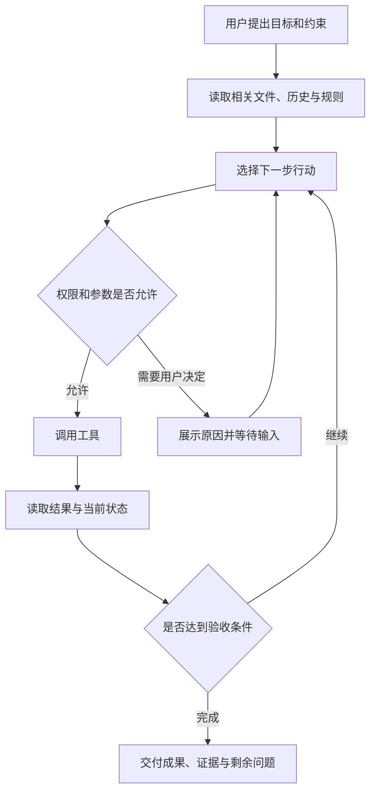

# AI 产品拆解：先建立一张地图

核对日期：2026-10-17，Asia/Shanghai。面向 AI 产品经理与 Agent Harness 产品经理面试。

## 这份材料怎么读

这是一份基于官方文档的产品研究，结合我们实际工作流中的案例分析。没有登录或付费实测所有产品，不给没有统一实验支撑的性能排名。功能随版本、地区、套餐与组织设置变化；文中的产品判断和改进建议，均是基于资料作出的分析。

覆盖重点是对话、办公、编程、个人助理及其开发平台。图像、音频、视频作为多模态能力介绍，不逐个展开全部模型、套餐和垂直应用。

| 顺序 | 文件 | 主要解决的问题 |
| --- | --- | --- |
| 1 | [OpenAI 与 Codex](01_OpenAI%E4%BA%A7%E5%93%81%E4%B8%8ECodex%E9%87%8D%E7%82%B9%E6%8B%86%E8%A7%A3.md) | GPT、ChatGPT、Codex、API 分别是什么；重点理解 Codex 的工作闭环 |
| 2 | [Claude 与 Cowork](02_Claude%E4%BA%A7%E5%93%81%E4%B8%8ECowork.md) | Claude 的内容、办公、编程与平台能力如何分工 |
| 3 | [Cursor、OpenCode、Copilot](03_Cursor_OpenCode_GitHubCopilot.md) | 同样能改代码，入口、控制权与团队流程有什么差别 |
| 4 | [Manus、OpenClaw、Hermes](04_Manus_OpenClaw_Hermes.md) | 托管任务执行、自建个人助理和经验积累怎样比较 |
| 5 | [横向比较与面试问题](05_%E6%A8%AA%E5%90%91%E6%AF%94%E8%BE%83%E4%B8%8E%E9%9D%A2%E8%AF%95%E8%A1%A8%E8%BE%BE.md) | 把功能介绍变成产品判断，并映射到自己的经历 |
| 6 | [上手验证与评估](06_%E4%BD%93%E9%AA%8C%E4%BB%BB%E5%8A%A1%E4%B8%8E%E8%AF%84%E4%BC%B0%E8%A1%A8.md) | 怎样积累第一手证据，避免只背产品宣传 |
| 查阅 | [官方来源与核验范围](99_%E5%AE%98%E6%96%B9%E6%9D%A5%E6%BA%90%E4%B8%8E%E6%A0%B8%E9%AA%8C%E8%8C%83%E5%9B%B4.md) | 查原始资料，识别已确认和待实测的内容 |

时间有限时：先读本篇、Codex 篇和横向比较篇。准备 Harness 方向时，再读 Claude Code、OpenCode、OpenClaw 和 Hermes 的执行、权限与记忆部分。

## 一、先分清五个层次

| 层次 | 解决什么 | 举例 | 最容易混淆的点 |
| --- | --- | --- | --- |
| 模型 | 理解输入、生成内容、选择下一步行动 | GPT、Claude 的模型系列 | 模型支持工具调用，不等于它已经接好了工具 |
| 执行系统／Harness | 管理会话、工具循环、权限、状态和恢复 | Codex 的执行系统、Claude Code 的执行系统 | 在聊天框写角色设定，不能替代这些执行机制 |
| 用户产品 | 让特定人群完成任务 | ChatGPT、Cowork、Cursor、Manus | 入口和交付方式会改变用户承担的工作 |
| 扩展与连接 | 引入知识、流程和外部动作 | MCP、Skills、插件、连接器、Hooks | 接入一个服务，不代表所有动作都已授权 |
| 团队运行与治理 | 控制账号、成本、数据和交付 | 管理策略、审查、审计、预算 | 功能可用，不代表当前账号或组织允许使用 |

这个分层是本材料的分析框架。OpenAI 对 Harness 的描述涉及上下文、工具、进度、失败与审批等执行能力，可以作为理解第二层的参考。[官方说明](https://developers.openai.com/blog/codex-as-a-platform)

## 二、按用户正在做的事分组

| 用户此刻的任务 | 代表入口 | 核心交付对象 | 产品研究重点 |
| --- | --- | --- | --- |
| 想清楚、问明白、共同起草 | ChatGPT Chat、Claude 对话 | 回答、论证、草稿 | 澄清质量、引用、可修改性 |
| 完成一份可用成果 | ChatGPT Work、Claude/Cowork、Manus | 报告、表格、演示、网页、文件 | 多步骤执行、进度、交付位置、返工成本 |
| 正在编辑代码 | Cursor、Copilot IDE、Codex IDE | 当前文件和多文件改动 | 上下文获取、延迟、接受与撤销 |
| 委托一项工程任务 | Codex、Claude Code、OpenCode、各家的云端 Agent | 可验证的代码变更和运行证据 | 环境、工具、测试、恢复、审查 |
| 持续管理个人事务 | OpenClaw、Hermes；部分托管常驻 Agent | 跨时间的提醒、处理结果和记忆 | 身份、主动性、记忆修订、长期成本 |
| 把 Agent 做进自己的产品 | API、SDK、app-server 等 | 可集成的调用与事件接口 | 接口契约、权限、状态、可观测性 |

这里按主要工作方式归类，不意味着这些产品只能出现在一行。官方文档已显示明显重叠：例如 ChatGPT Work 与 Codex 共享部分能力，Claude 正逐步把对话与 Cowork 合并。[OpenAI](https://learn.chatgpt.com/docs/use-chatgpt)、[Anthropic](https://support.claude.com/en/articles/16761823-claude-cowork-and-chat-are-one-claude)

## 三、看懂一个 Agent 的执行闭环

这是帮助比较产品的抽象流程，不是某家的源码，也不要求展示模型的内部思考过程。产品需要展示的是计划、动作、结果和需要人决定的事项。

拆解每个产品时，都沿着这个流程问：哪一步由模型决定，哪一步由程序控制，哪一步必须交给人？

## 四、统一使用八个问题

1. **为谁服务？**个人开发者、团队、知识工作者，还是愿意维护自建系统的人？
2. **接管多大的任务？**一句补全、一个文件、一项功能，还是长期事务？
3. **上下文从哪来？**选中代码、仓库、文件夹、连接器、历史、记忆分别怎样进入？
4. **在哪里执行？**本机、云端环境、远程机器、浏览器，还是混合执行？
5. **人在哪里介入？**计划、敏感操作、登录、选片、审查、合并、发布？
6. **错了怎么办？**纠正、重试、恢复会话、撤销文件和补偿外部动作分别怎么做？
7. **怎么证明做完了？**只给总结，还是有变更、测试、可预览文件和操作记录？
8. **增长和成本如何成立？**为什么反复回来用，谁付费，按席位、调用、算力或任务消耗什么？

对每个功能，继续追问它减少了哪一种劳动：输入、寻找上下文、执行、等待、判断、纠错，还是交付？

## 五、面试中常用术语的具体含义

| 术语 | 可以怎样解释 | 不应自动推导出的结论 |
| --- | --- | --- |
| Agent Loop | 行动、观察结果、决定后续行动的循环 | 运行越久就越有效 |
| Tool Use | 用结构化调用读文件、运行命令或操作服务 | 模型说调用成功，外部动作就一定完成 |
| MCP | 给工具和数据连接提供统一接口的协议 | 一个协议就解决了登录、权限和所有兼容问题 |
| Skill | 可复用的任务说明及支持资源 | 写进 Skill 的规则都被程序强制执行 |
| Hook | 在特定执行事件触发的处理或检查 | 所有 Hook 都有相同的阻断能力 |
| Memory | 跨会话保留和调用的信息或经验 | 等同于训练模型参数 |
| Subagent | 有独立上下文、承担子任务的 Agent | 一定比单 Agent 更快、更准、更省钱 |
| Worktree | Git 提供的另一份工作检出 | 等同于操作系统安全沙箱 |
| Sandbox | 约束文件、进程或网络的执行环境 | 里面做过的所有动作都可撤销 |
| Checkpoint | 某一范围的状态快照 | 能撤回邮件、数据库变更和所有终端命令 |

扩展机制的具体约束需要逐产品核对。例如 OpenAI 把 Skill 与插件分开说明，Claude Code 也明确区分指导模型的文件与程序执行的权限规则。[Skills 与插件](https://learn.chatgpt.com/docs/skills-and-plugins)、[Claude Code 权限](https://code.claude.com/docs/en/permissions)

## 六、产品比较中最有价值的两条轴

### 任务跨度：从局部操作到持续委托

跨度变大时，产品需要解决进度、状态、环境、恢复、审查和成本。把聊天框做大，不能独自解决这些问题。

### 控制方式：从每步确认到结果审查

更少打断能减少用户负担，但要求更好的边界、证据和接管入口。更频繁确认也可能让用户机械点击，因此应评估有效干预，而非只统计弹窗数量。

这两条轴帮助解释产品取舍，不构成能力排名。同一款产品可能同时提供多种工作方式。
